# Pac-Man (C#, .NET 10, SDL3): UML and State Diagrams

This document describes the final architecture of the game through 18 diagrams: one package diagram, 6 class diagrams, 2 sequence diagrams and 9 state diagrams, all derived from the source code. The game is split into two projects: the `PACMAN.Core` library, independent of any platform (rules, software rendering, audio mixing), and the `PACMAN.Sdl` host, which opens the window, reads keyboard and gamepad and plays sound with SDL3 on Windows and Linux. The diagrams are written in [Mermaid](https://mermaid.js.org) and render directly in Markdown viewers that support it (GitHub, GitLab, VS Code with an extension, Obsidian, and so on).

## 1. Overview

The `PACMAN.Sdl` project (Program, SdlHost, SdlAudioOutput) is the only part that knows SDL3. It drives the `PACMAN.Core` library, whose seven folders form three levels: the platform (Platform) and the screens (Screens) drive the game (Game, Ghosts, Maze), which relies on rendering (Graphics) and audio (Audio). Game and Ghosts are tightly coupled: Game creates the four ghosts, and a ghost reads Pacman and LevelSpecs, both defined in Game. Rendering and audio depend on no graphics or sound API: GameRenderer draws into a Canvas (a pixel array) and MixerAudioEngine produces samples that the host sends to the sound card.

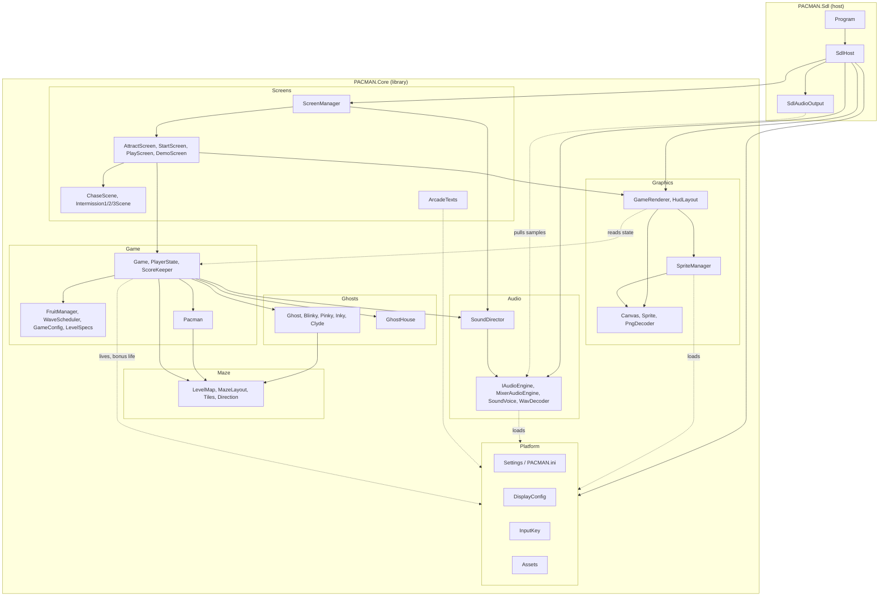

*Figure 1: package diagram: the PACMAN.Sdl host, the seven PACMAN.Core folders and their dependencies*  
Open full size: [SVG](diagrams/en/01_paquets.svg) · [PNG](diagrams/en/01_paquets.png)

| Folder | Role | Main classes |
| --- | --- | --- |
| PACMAN.Sdl (project) | SDL3 host: window, full screen, keyboard, gamepad, fixed-step loop, audio output | Program, SdlHost, SdlAudioOutput |
| Platform | `PACMAN.ini` settings, abstract keys, access to embedded resources | Settings, DisplayConfig, InputKey, Assets |
| Screens | Screen flow, credits, intermissions | ScreenManager, IScreen, AttractScreen, StartScreen, PlayScreen, DemoScreen, Intermission1/2/3Scene |
| Game | Rules and state of a game | Game, PlayerState, ScoreKeeper, FruitManager, WaveScheduler, Pacman, GameConfig |
| Ghosts | Ghost and ghost house behavior | Ghost, Blinky, Pinky, Inky, Clyde, GhostHouse |
| Maze | Maze, tiles, directions | LevelMap, MazeLayout, Tiles, Direction |
| Graphics | Software drawing at arcade resolution (224×288) | GameRenderer, SpriteManager, HudLayout, Canvas, Sprite, PngDecoder |
| Audio | Sounds, software mixing and volume | SoundDirector, IAudioEngine, MixerAudioEngine, SoundVoice, WavDecoder |

## 2. Class diagrams

The members shown are the most significant ones, not the full list. Relationships follow UML: hollow arrow for inheritance or interface implementation, filled diamond for composition, hollow diamond for aggregation, dashed line for a dependency.

### 2.1 Screens and navigation

Program creates the SdlHost, which owns a ScreenManager. The latter holds the current screen behind the IScreen interface. Credits, the high score and sound cross screens: they live in the ScreenManager. SdlHost translates keyboard and gamepad input into InputKey, which keeps the screens independent of SDL.

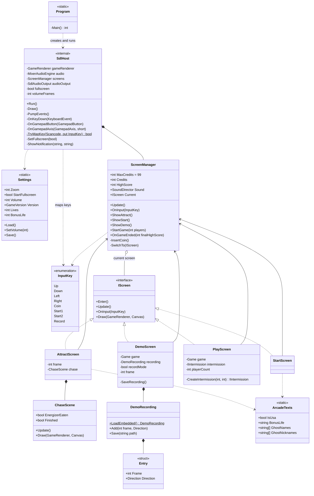

*Figure 2: class diagram: screens and navigation*  
Open full size: [SVG](diagrams/en/02_classes_ecrans.svg) · [PNG](diagrams/en/02_classes_ecrans.png)

### 2.2 Intermissions

PlayScreen displays a single IIntermission at a time and pauses the Game meanwhile. The Game only knows the number of the act to play (1, 2 or 3); PlayScreen creates the matching scene.

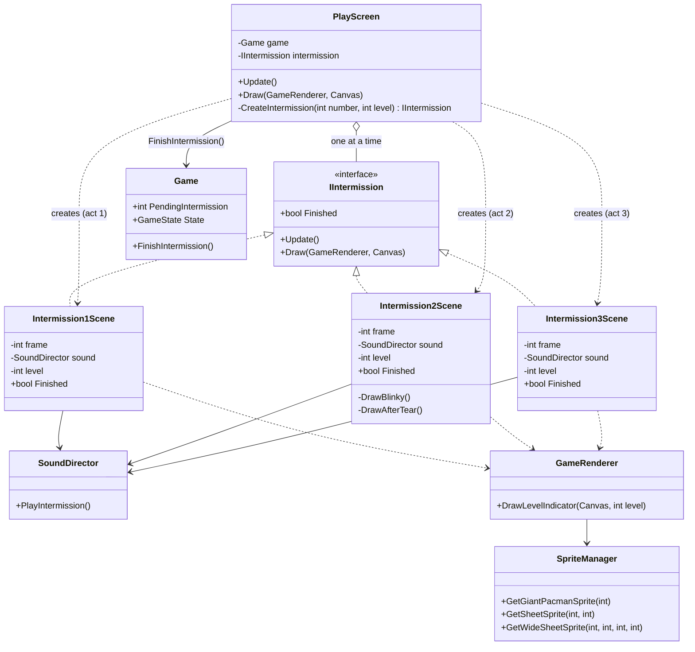

*Figure 3: class diagram: intermissions*  
Open full size: [SVG](diagrams/en/03_classes_intermissions.svg) · [PNG](diagrams/en/03_classes_intermissions.png)

### 2.3 Game engine

Game is the center of the engine. It chains the GameState states, delegates the rules to ScoreKeeper, FruitManager, WaveScheduler and GhostHouse, and keeps one PlayerState per player, each with its own maze.

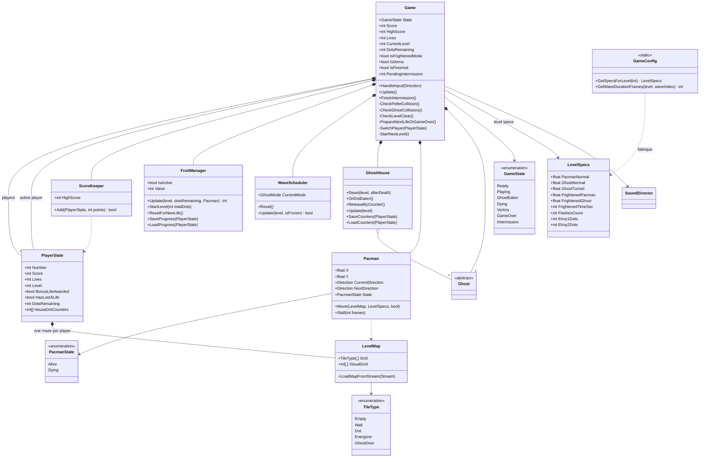

*Figure 4: class diagram: game engine*  
Open full size: [SVG](diagrams/en/04_classes_moteur.svg) · [PNG](diagrams/en/04_classes_moteur.png)

### 2.4 Ghosts

Ghost holds everything common: pixel-by-pixel movement, direction choice, speed, reversal. Each ghost only defines its chase target. Inky keeps a reference to Blinky to compute its own, and Blinky adds the Cruise Elroy state.

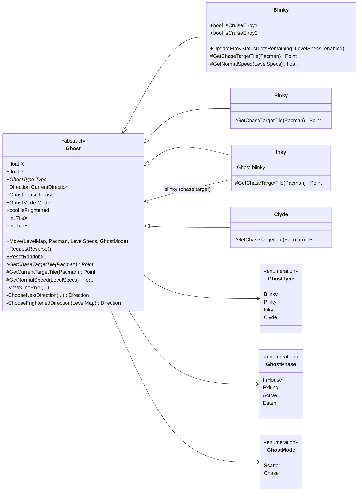

*Figure 5: class diagram: ghosts*  
Open full size: [SVG](diagrams/en/05_classes_fantomes.svg) · [PNG](diagrams/en/05_classes_fantomes.png)

### 2.5 Rendering

GameRenderer draws everything into a native 224×288 Canvas (0xAARRGGBB pixels), then the host hands it to SDL, which scales it up by the nearest integer factor. A Sprite is just a rectangular view on a Canvas, with no pixel copy. PngDecoder decodes the single sheet `asset.png` and SpriteManager slices it into cached sprites.

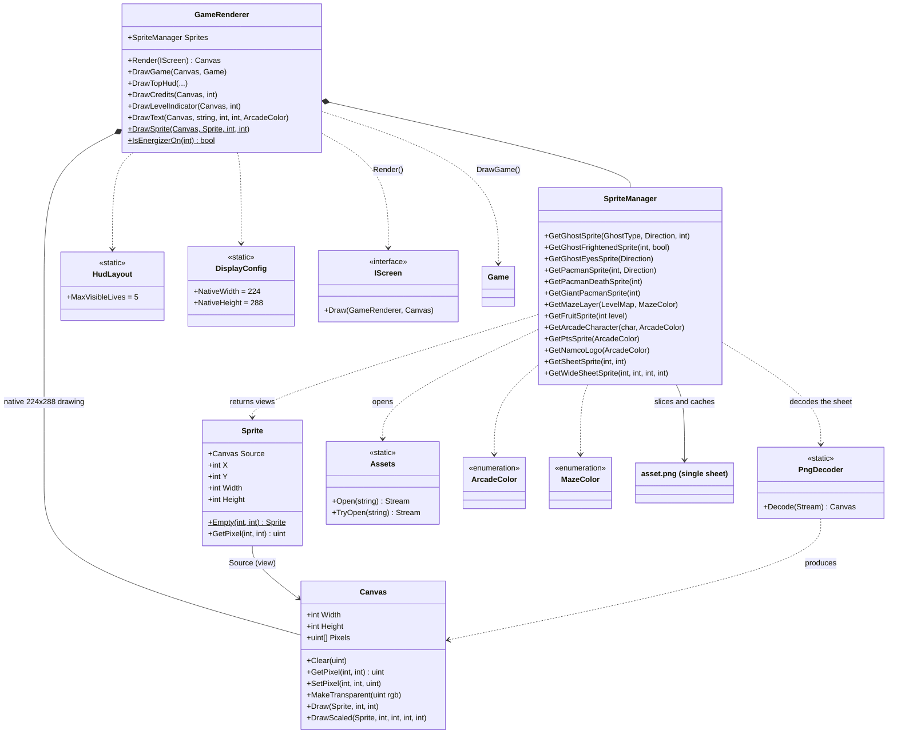

*Figure 6: class diagram: rendering*  
Open full size: [SVG](diagrams/en/06_classes_rendu.svg) · [PNG](diagrams/en/06_classes_rendu.png)

### 2.6 Audio

SoundDirector turns game events into sounds and guarantees that only one background sound plays at a time, through the IAudioEngine interface. MixerAudioEngine decodes the 24 sounds at startup (WavDecoder), mixes them itself as 48 kHz stereo floats and applies the volume. It knows no audio output: SdlAudioOutput, on the host side, calls Read() from the SDL callback to fill the sound card buffer.

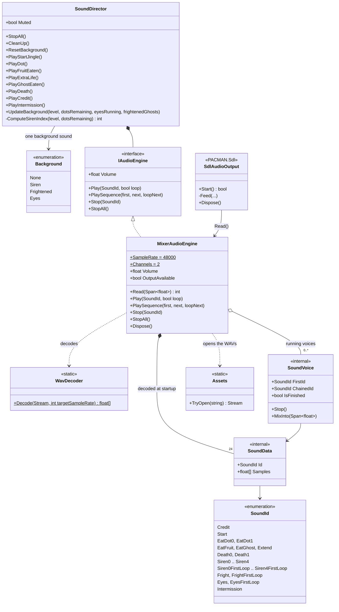

*Figure 7: class diagram: audio*  
Open full size: [SVG](diagrams/en/07_classes_audio.svg) · [PNG](diagrams/en/07_classes_audio.png)

## 3. Sequence diagrams

### 3.1 One game frame at 60 Hz

The SdlHost.Run loop accumulates the elapsed time and calls the logic update as many times as needed, at a fixed step of 1/60 s (catch-up capped at 100 ms), before redrawing. The Canvas produced by GameRenderer is then copied into an SDL texture and presented. Game speed therefore stays identical whatever the machine.

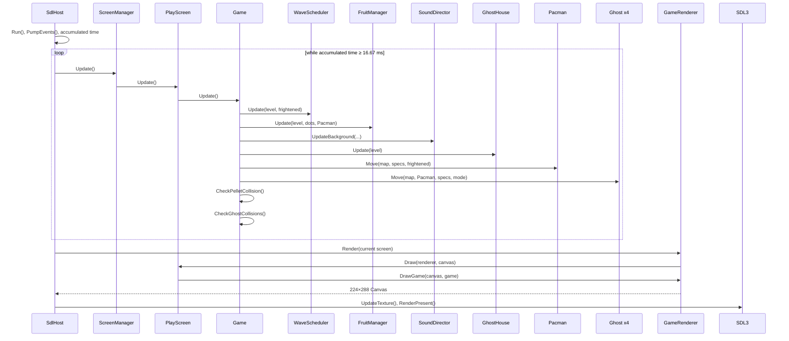

*Figure 17: sequence diagram: one game frame at 60 Hz*  
Open full size: [SVG](diagrams/en/17_sequence_image.svg) · [PNG](diagrams/en/17_sequence_image.png)

### 3.2 From a credit to the start of a game

A credit leads from the attract mode to the start screen; key 1 starts a game and consumes a credit. At the end of GAME OVER, the ScreenManager returns to the start screen if credits remain, otherwise to the attract mode.

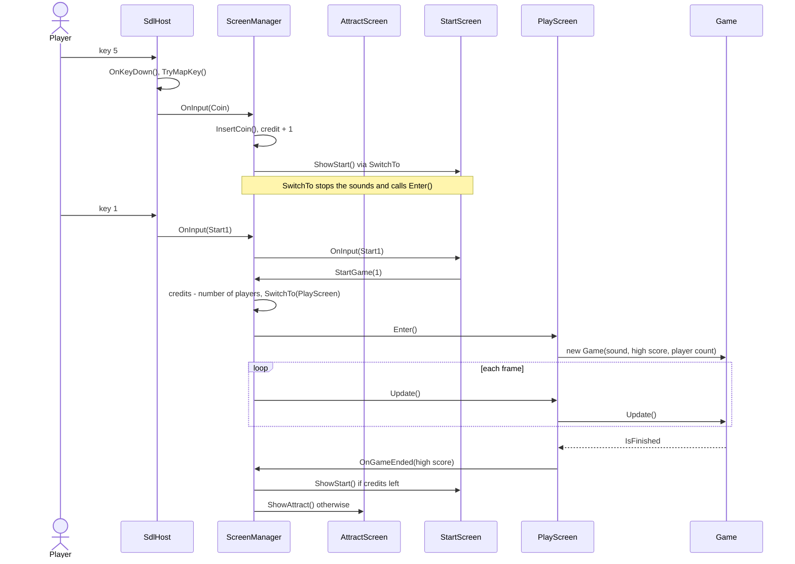

*Figure 18: sequence diagram: from a credit to the start of a game*  
Open full size: [SVG](diagrams/en/18_sequence_credit.svg) · [PNG](diagrams/en/18_sequence_credit.png)

## 4. State diagrams

Each diagram corresponds to an enumeration or a timeline in the code. Durations are in frames at 60 Hz (60 frames = 1 second).

### 4.1 Screen cycle

The ScreenManager chains attract mode, demo, start screen and game. A credit is accepted at any time: it leaves the attract mode or the demo for the start screen, and is simply added to the counter elsewhere. Demo recording (F9) only exists in Debug builds.

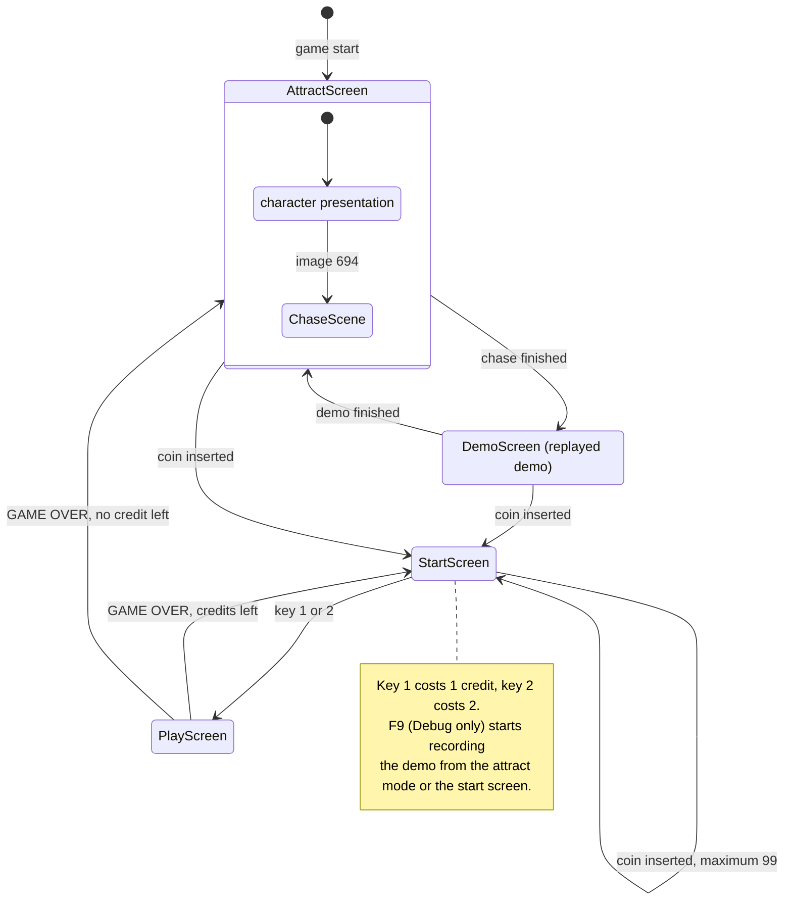

*Figure 8: state diagram: screen cycle*  
Open full size: [SVG](diagrams/en/08_etats_ecrans.svg) · [PNG](diagrams/en/08_etats_ecrans.png)

### 4.2 Game states

Game goes through seven states (GameState). Dying and Victory are split into timed phases. In demo mode, a death ends after the animation and one second of pause, and a victory ends the demo immediately.

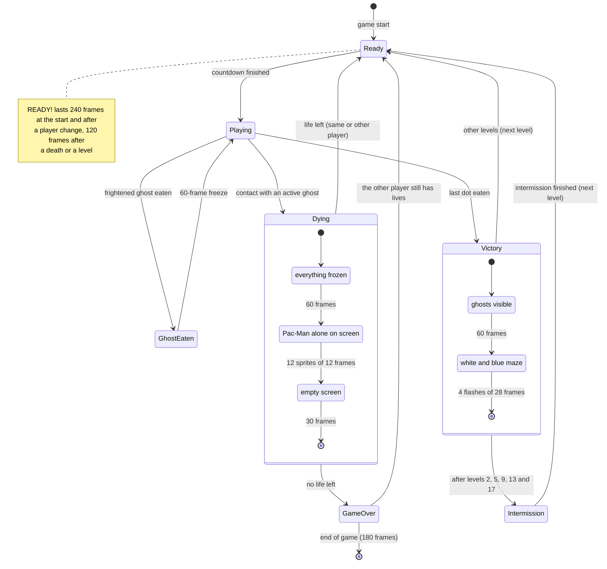

*Figure 9: state diagram: game states*  
Open full size: [SVG](diagrams/en/09_etats_partie.svg) · [PNG](diagrams/en/09_etats_partie.png)

### 4.3 Ghost life cycle

Four phases (GhostPhase). When the ghost is active, two dimensions evolve independently: the wave mode (Scatter or Chase) and the frightened state.

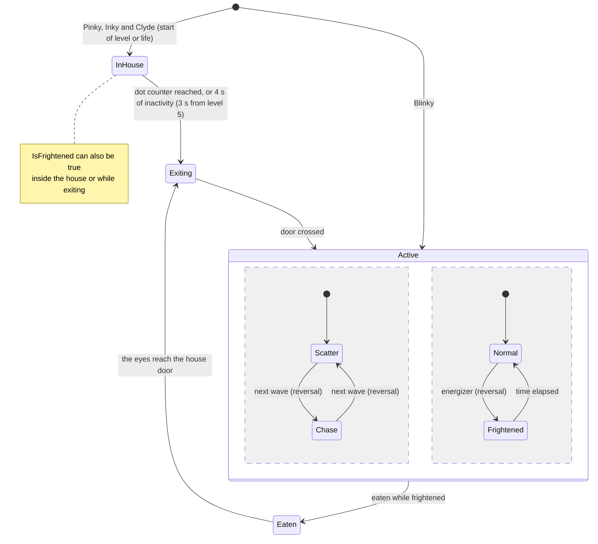

*Figure 10: state diagram: ghost life cycle*  
Open full size: [SVG](diagrams/en/10_etats_fantome.svg) · [PNG](diagrams/en/10_etats_fantome.png)

### 4.4 Scatter / Chase waves

Eight waves alternate; the last one (Chase) lasts until the end of the level. Durations depend on the level (`GameConfig.GetWaveDurationFrames`).

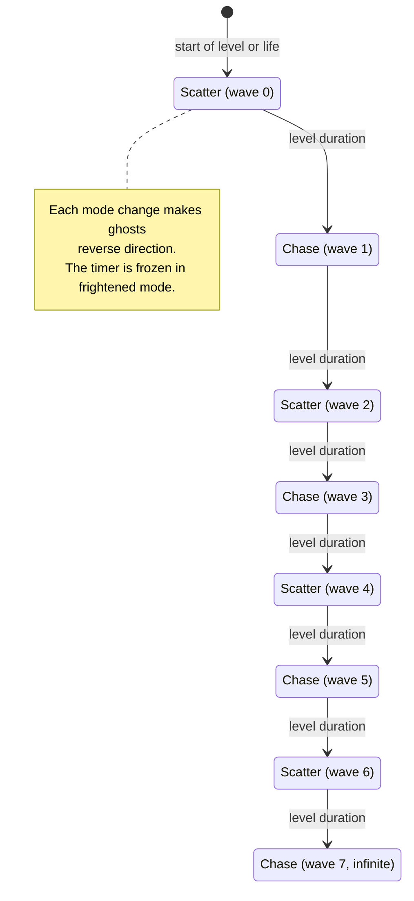

*Figure 11: state diagram: Scatter and Chase waves*  
Open full size: [SVG](diagrams/en/11_etats_vagues.svg) · [PNG](diagrams/en/11_etats_vagues.png)

### 4.5 Background sound

Only one background sound plays at a time, by priority: eyes, then panic, then siren. The siren speeds up in steps when few dots remain.

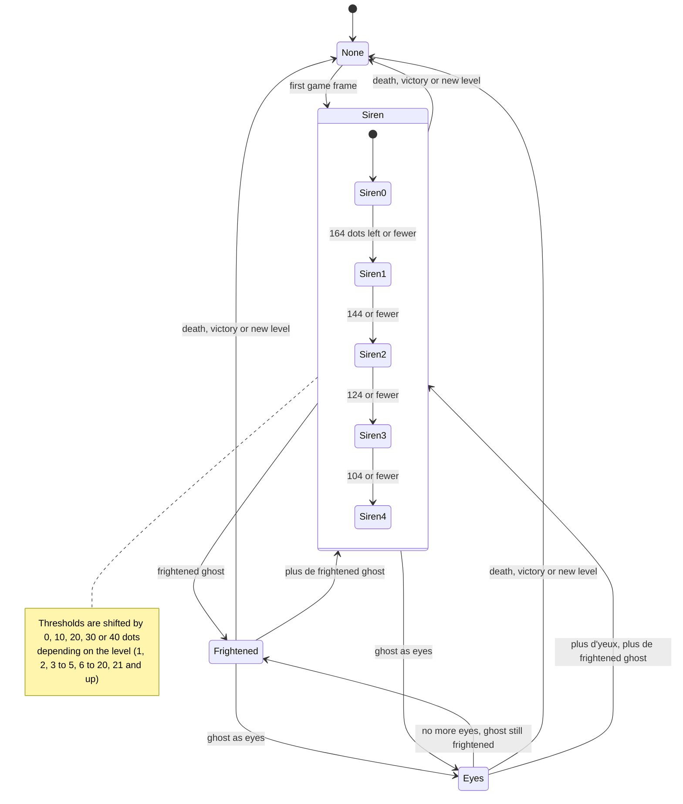

*Figure 12: state diagram: background sound*  
Open full size: [SVG](diagrams/en/12_etats_son.svg) · [PNG](diagrams/en/12_etats_son.png)

### 4.6 Two-player mode

Players alternate after each lost life as long as the other player still has lives. A player with no lives left hands over to the other after their GAME OVER.

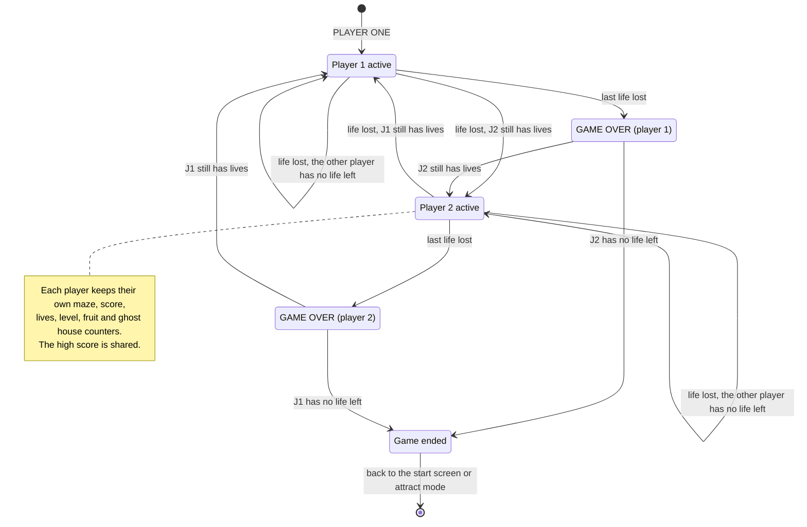

*Figure 13: state diagram: two-player mode*  
Open full size: [SVG](diagrams/en/13_etats_deux_joueurs.svg) · [PNG](diagrams/en/13_etats_deux_joueurs.png)

### 4.7 Intermission 1 (after level 2)

Pac-Man crosses the screen to the left, gradually caught up by Blinky; then a blue Blinky goes back to the right, chased by a giant Pac-Man. The 5-second music, played twice, starts at frame 20.

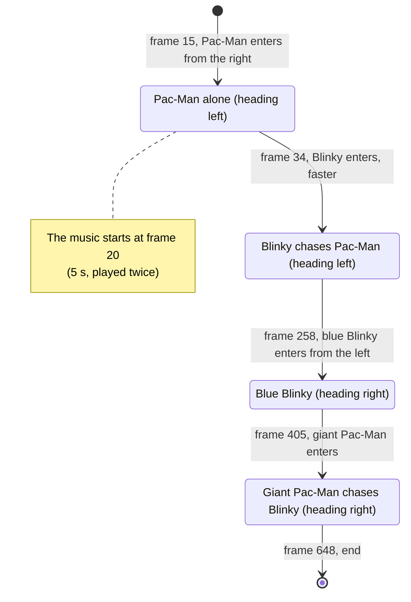

*Figure 14: state diagram: intermission 1*  
Open full size: [SVG](diagrams/en/14_etats_intermission1.svg) · [PNG](diagrams/en/14_etats_intermission1.png)

### 4.8 Intermission 2 (after level 5)

Blinky's cloth catches on a nail and stretches through three successive sprites before tearing. The music is cut off sharply at the end of the scene, after the black screen.

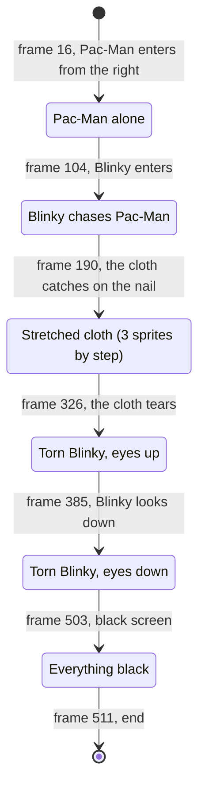

*Figure 15: state diagram: intermission 2*  
Open full size: [SVG](diagrams/en/15_etats_intermission2.svg) · [PNG](diagrams/en/15_etats_intermission2.png)

### 4.9 Intermission 3 (after levels 9, 13 and 17)

Pac-Man, chased by Blinky with his cloth sewn back, exits to the left; the screen stays empty for a moment, then Blinky, undressed, crawls to the right dragging his cloth.

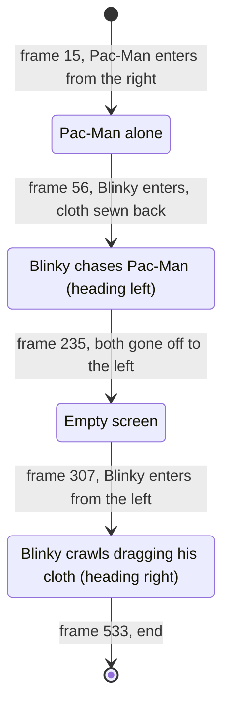

*Figure 16: state diagram: intermission 3*  
Open full size: [SVG](diagrams/en/16_etats_intermission3.svg) · [PNG](diagrams/en/16_etats_intermission3.png)

## 5. Analysis of ghost behavior

The four ghosts follow the same movement rule; only the tile they aim for changes, depending on their state and personality.

### 5.1 How a ghost chooses its direction

At each tile center, a ghost picks the exit whose next tile is closest to its target, using squared Euclidean distance. There is no pathfinding and no memory: the decision is local, which produces the predictable trajectories of the arcade.

- Candidate directions are tested in the order Up, Left, Down, Right; in case of a tie, the first one wins.
- Reversing is forbidden, except for a reversal imposed by a mode change.
- Walls and the ghost house door are excluded (only eyes may cross the door).
- At the four intersections (12,14), (15,14), (12,26) and (15,26), an active ghost cannot turn upward.

### 5.2 Target by state

| State | Target | Note |
| --- | --- | --- |
| Scatter | The ghost's own corner | They loop around a block |
| Chase | Tile computed by each ghost (5.4) | The only difference in personality |
| Frightened | None: pseudo-random choice | Order Up, Right, Down, Left, fixed seed |
| Eaten (eyes) | Tile (13,14), in front of the house | Speed 2 px per frame |

### 5.3 Alternation of Scatter and Chase

A scheduler of 8 waves alternates Scatter (even waves) and Chase (odd waves), then stays in Chase forever at the 8th. The higher the level, the shorter the Scatter phase, until it becomes a mere direction reversal.

| Wave | Level 1 | Levels 2 to 4 | Levels 5 and up |
| --- | --- | --- | --- |
| 1 Scatter | 7 s | 7 s | 5 s |
| 2 Chase | 20 s | 20 s | 20 s |
| 3 Scatter | 7 s | 7 s | 5 s |
| 4 Chase | 20 s | 20 s | 20 s |
| 5 Scatter | 5 s | 5 s | 5 s |
| 6 Chase | 20 s | 1033 s | 1037 s |
| 7 Scatter | 5 s | 1 frame | 1 frame |
| 8 Chase | infinite | infinite | infinite |

Three rules complete this table:

- The timer is frozen while ghosts are frightened.
- At every wave change, all ghosts receive a request to reverse direction: this is the only visible signal of a mode change.
- A ghost leaving the house takes the current mode; those still inside keep the reversal request and therefore exit to the right instead of the left.

An energizer also requests the reversal, even when the level's frightened duration is zero (levels 17, 19, 20 and beyond).

### 5.4 What sets the four ghosts apart

Blinky aims at Pac-Man; the others aim at a computed point meant to cut off or avoid his path. This variety is what makes the pincer chase work.

| Ghost | Chase target | Scatter corner | Role |
| --- | --- | --- | --- |
| Blinky (red) | Pac-Man's tile | Top right, (25,0) | Direct pursuer, speeds up (Elroy) |
| Pinky (pink) | 4 tiles ahead of Pac-Man | Top left, (2,0) | Ambush |
| Inky (blue) | Mirror of Blinky through a point 2 tiles ahead of Pac-Man | Bottom right, (27,34) | Unpredictable, depends on Blinky |
| Clyde (orange) | Pac-Man if 8 or more tiles away, otherwise his own corner | Bottom left, (0,34) | Chases from afar, flees up close |

**Blinky** computes nothing: he aims at the tile Pac-Man occupies and follows him closely. He gets faster when few dots remain (Cruise Elroy, below) and does not go back to his corner while in Elroy.

**Pinky** aims 4 tiles ahead of Pac-Man in his direction. When Pac-Man goes up, the target is also shifted 4 tiles to the left: this is the arcade's overflow bug, deliberately reproduced. Turning around in front of Pinky often makes him head the other way.

**Inky** is the most complex: take the point 2 tiles ahead of Pac-Man (with the same 2-tile shift to the left when he goes up), draw the vector from Blinky to that point, then double it. Inky therefore ends up on the other side of Pac-Man from Blinky; alone he is harmless, but combined with Blinky he closes off the exits.

**Clyde** alternates: if he is 8 or more tiles from Pac-Man (squared distance of 64 or more), he targets him like Blinky; as soon as he gets close, he targets his bottom-left corner and moves away. He ends up circling that corner without ever cornering the player.

### 5.5 Cruise Elroy

When few dots remain, Blinky speeds up in two steps and chases Pac-Man even during Scatter phases. The threshold depends on the level; the second step is at half of the first.

| Levels | Dots remaining (step 1 / step 2) | Speed step 1 / step 2 |
| --- | --- | --- |
| 1 | 20 / 10 | 0.80 / 0.85 |
| 2 | 30 / 15 | 0.90 / 0.95 |
| 3 to 4 | 40 / 20 | 0.90 / 0.95 |
| 5 | 40 / 20 | 1.00 / 1.05 |
| 6 to 8 | 50 / 25 | 1.00 / 1.05 |
| 9 to 11 | 60 / 30 | 1.00 / 1.05 |
| 12 to 14 | 80 / 40 | 1.00 / 1.05 |
| 15 to 18 | 100 / 50 | 1.00 / 1.05 |
| 19 and up | 120 / 60 | 1.00 / 1.05 |

After Pac-Man dies, Elroy is suspended until Clyde leaves the house.

### 5.6 Leaving the ghost house

Ghosts do not leave together: each waits until Pac-Man has eaten enough dots. If Pac-Man stops eating, a timer forces the first waiting ghost out.

| Ghost | Level 1 | Level 2 | Level 3 and up |
| --- | --- | --- | --- |
| Blinky | Outside from the start | Outside | Outside |
| Pinky | 0 dots | 0 | 0 |
| Inky | 30 dots | 0 | 0 |
| Clyde | 60 dots | 50 | 0 |

After a death, a global counter replaces these thresholds (Pinky at 7, Inky at 17, Clyde at 32 dots). The forced-exit timer is 4 s on levels 1 to 4 and 3 s afterwards.

### 5.7 Key takeaways

- The danger comes from the combination: Blinky pushes, Pinky cuts off, Inky closes the other side and Clyde eases the pressure up close.
- Scatter is not a break: it disperses the ghosts to break the pincer, and barely lasts at high levels.
- Direction reversals, not colors or sounds, announce a mode change.
- The "faulty" behaviors (Pinky's and Inky's upward shift, the no-Up intersections) are those of the original arcade and are kept.
