# Pac-Man and Ms. Pac-Man (C#, .NET 10, SDL3): UML and State Diagrams

This document describes the final architecture of the game through 31 diagrams: one package diagram, 7 class diagrams, 3 sequence diagrams and 20 state diagrams, all derived from the source code. The program offers two games, Pac-Man and Ms. Pac-Man, which share the same engine: everything that differs between the games is gathered in a `GameVariant` class. Chapters 1 to 4 describe what is common to both games; chapter 5 is devoted to the original Pac-Man and chapter 6 to the Ms. Pac-Man variant. The game is split into two projects: the `PACMAN.Core` library, independent of any platform (rules, software rendering, audio mixing), and the `PACMAN.Sdl` host, which opens the window, reads keyboard and gamepad and plays sound with SDL3 on Windows and Linux. The diagrams are written in [Mermaid](https://mermaid.js.org) and render directly in Markdown viewers that support it (GitHub, GitLab, VS Code with an extension, Obsidian, and so on); each one is also provided as SVG and PNG. In the PDF version, the large diagrams are placed on landscape pages.

## 1. Overview

The `PACMAN.Sdl` project (Program, SdlHost, SdlAudioOutput) is the only part that knows SDL3. It drives the `PACMAN.Core` library, whose seven folders form three levels: the platform (Platform) and the screens (Screens) drive the game (Game, Ghosts, Maze), which relies on rendering (Graphics) and audio (Audio). Game and Ghosts are tightly coupled: Game creates the four ghosts, and a ghost reads Pacman and LevelSpecs, defined in Game. Rendering and audio depend on no graphics or sound API: GameRenderer draws into a Canvas (a pixel array) and MixerAudioEngine produces samples that the host sends to the sound card. The two games (Pac-Man and Ms. Pac-Man) differ only through their `GameVariant`, which supplies the mazes, the ghosts, the fruit, the sprites, the sounds, the screens and the intermissions; the engine has no direct knowledge of any particular game.

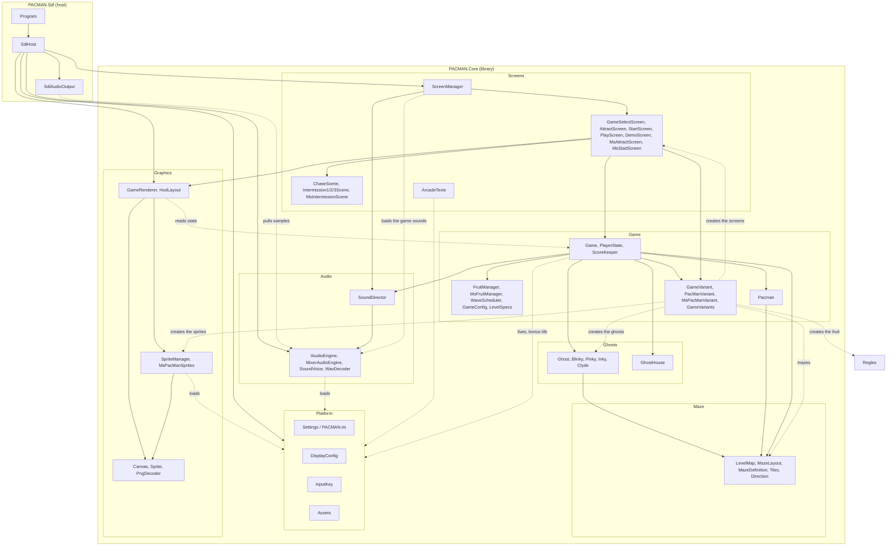

*Figure 1: package diagram: the PACMAN.Sdl host, the seven PACMAN.Core folders and their dependencies*  
Open full size: [SVG](diagrams/en/01_paquets.svg) · [PNG](diagrams/en/01_paquets.png)

| Folder | Role | Main classes |
| --- | --- | --- |
| PACMAN.Sdl (project) | SDL3 host: window, full screen, keyboard, gamepad, fixed-step loop, audio output | Program, SdlHost, SdlAudioOutput |
| Platform | `PACMAN.ini` settings and `--game` option, abstract keys, access to embedded resources | Settings, DisplayConfig, InputKey, Assets |
| Screens | Game selection, screen flow, credits, intermissions | ScreenManager, IScreen, GameSelectScreen, AttractScreen, StartScreen, PlayScreen, DemoScreen, Intermission1/2/3Scene, MsAttractScreen, MsStartScreen, MsIntermissionScene |
| Game | Rules and state of a game, differences between the games | Game, PlayerState, ScoreKeeper, FruitManager, MsFruitManager, WaveScheduler, Pacman, GameConfig, GameVariant, PacManVariant, MsPacManVariant, GameVariants |
| Ghosts | Ghost and ghost house behavior | Ghost, Blinky, Pinky, Inky, Clyde, GhostHouse |
| Maze | Mazes, tiles, directions | LevelMap, MazeLayout, MazeDefinition, Tiles, Direction |
| Graphics | Software drawing at arcade resolution (224×288) | GameRenderer, SpriteManager, MsPacManSprites, HudLayout, Canvas, Sprite, PngDecoder |
| Audio | Sounds, software mixing and volume | SoundDirector, IAudioEngine, MixerAudioEngine, SoundVoice, WavDecoder |

## 2. Class diagrams

The members shown are the most significant ones, not the full list. Relationships follow UML: hollow arrow for inheritance or interface implementation, filled diamond for composition, hollow diamond for aggregation, dashed line for a dependency.

### 2.1 Screens and navigation

Program creates the SdlHost, which owns a ScreenManager. The latter holds the current screen behind the IScreen interface. At startup the ScreenManager shows the game selection menu (GameSelectScreen), unless a game is forced by the `--game` option or by `Game=` in `PACMAN.ini`. The chosen game (GameVariant) then creates its own attract and start screens, behind the IAttractScreen and IStartScreen interfaces. Credits, the high score and sound cross screens: they live in the ScreenManager. SdlHost translates keyboard and gamepad input into InputKey, which keeps the screens independent of SDL.

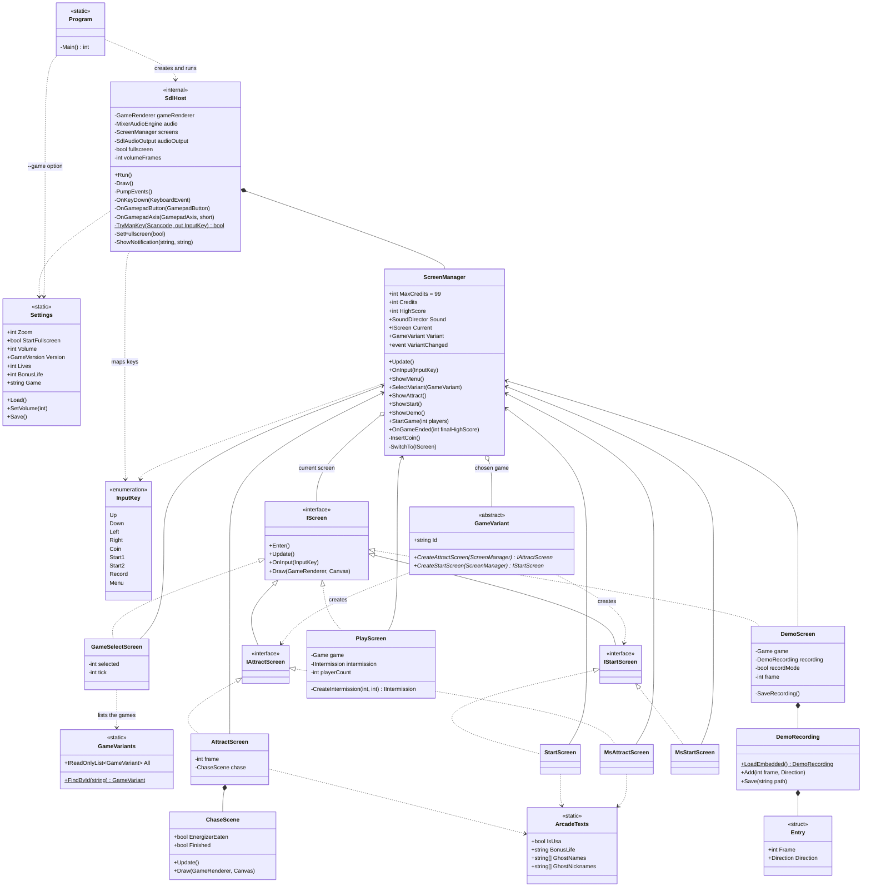

*Figure 2: class diagram: screens and navigation*  
Open full size: [SVG](diagrams/en/02_classes_ecrans.svg) · [PNG](diagrams/en/02_classes_ecrans.png)

### 2.2 Intermissions

PlayScreen displays a single IIntermission at a time and pauses the Game meanwhile. The Game only knows the number of the act to play (1, 2 or 3); the GameVariant of the chosen game creates the matching scene. Pac-Man has three scene classes, one per act, drawn in code. Ms. Pac-Man has a single class, MsIntermissionScene, which replays the three acts from tracks of sprite positions measured frame by frame on the arcade (MsIntermissionData).

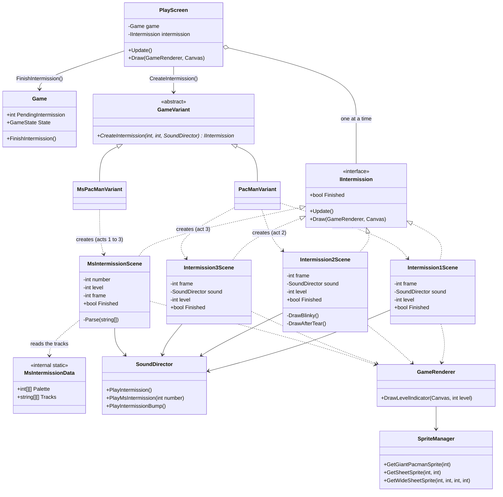

*Figure 3: class diagram: intermissions*  
Open full size: [SVG](diagrams/en/03_classes_intermissions.svg) · [PNG](diagrams/en/03_classes_intermissions.png)

### 2.3 Game engine

Game is the center of the engine. It chains the GameState states, delegates the rules to ScoreKeeper, FruitManager, WaveScheduler and GhostHouse, and keeps one PlayerState per player, each with its own maze. The rules that differ between the games (the level's maze, ghosts, fruit, wave durations, death animation) are requested from the GameVariant; FruitManager therefore has two versions, Pac-Man's fixed fruit and Ms. Pac-Man's moving fruit (MsFruitManager).

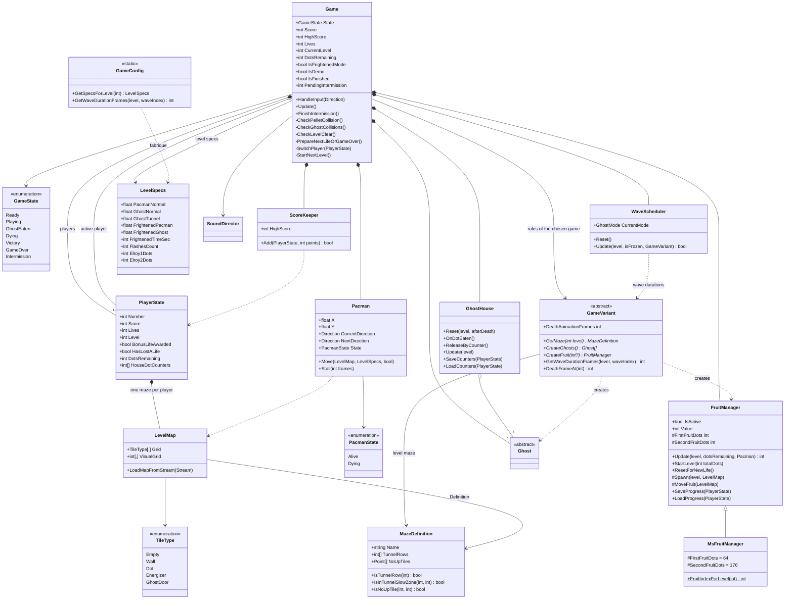

*Figure 4: class diagram: game engine*  
Open full size: [SVG](diagrams/en/04_classes_moteur.svg) · [PNG](diagrams/en/04_classes_moteur.png)

### 2.4 Ghosts

Ghost holds everything common: pixel-by-pixel movement, direction choice, speed, reversal. Each ghost only defines its chase target. Inky keeps a reference to Blinky to compute its own, and Blinky adds the Cruise Elroy state. Two options, enabled by the Ms. Pac-Man GameVariant, change the common behavior: `WandersInScatter` makes the ghost wander randomly during Scatter, and `ExitsTowardTarget` makes it choose its direction when leaving the house according to its target.

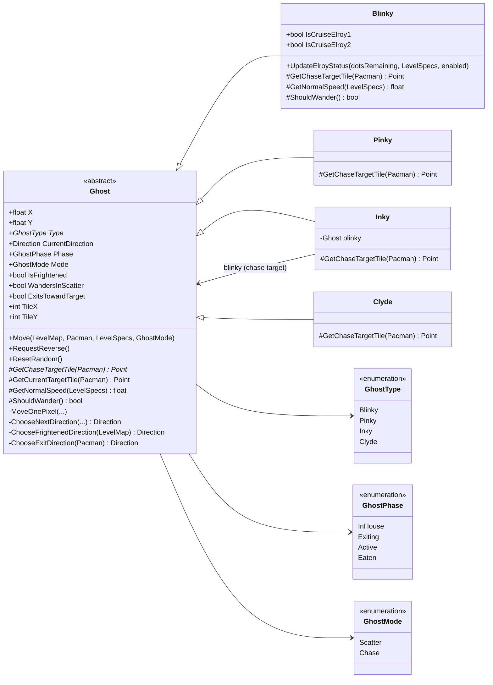

*Figure 5: class diagram: ghosts*  
Open full size: [SVG](diagrams/en/05_classes_fantomes.svg) · [PNG](diagrams/en/05_classes_fantomes.png)

### 2.5 Rendering

GameRenderer draws everything into a native 224×288 Canvas (0xAARRGGBB pixels), then the host hands it to SDL, which scales it up by the nearest integer factor. A Sprite is just a rectangular view on a Canvas, with no pixel copy. PngDecoder decodes the `asset.png` sheet of the chosen game and SpriteManager slices it into cached sprites. Each game has its own sheet: Ms. Pac-Man uses MsPacManSprites, which inherits from SpriteManager and overrides the slicing of the characters, the mazes, the fruits and the death animation. The GameRenderer switches sprite sets when the ScreenManager announces a new game (SetVariant) and can also provide another game's set (SpritesFor), which the selection menu uses to draw its cursor.

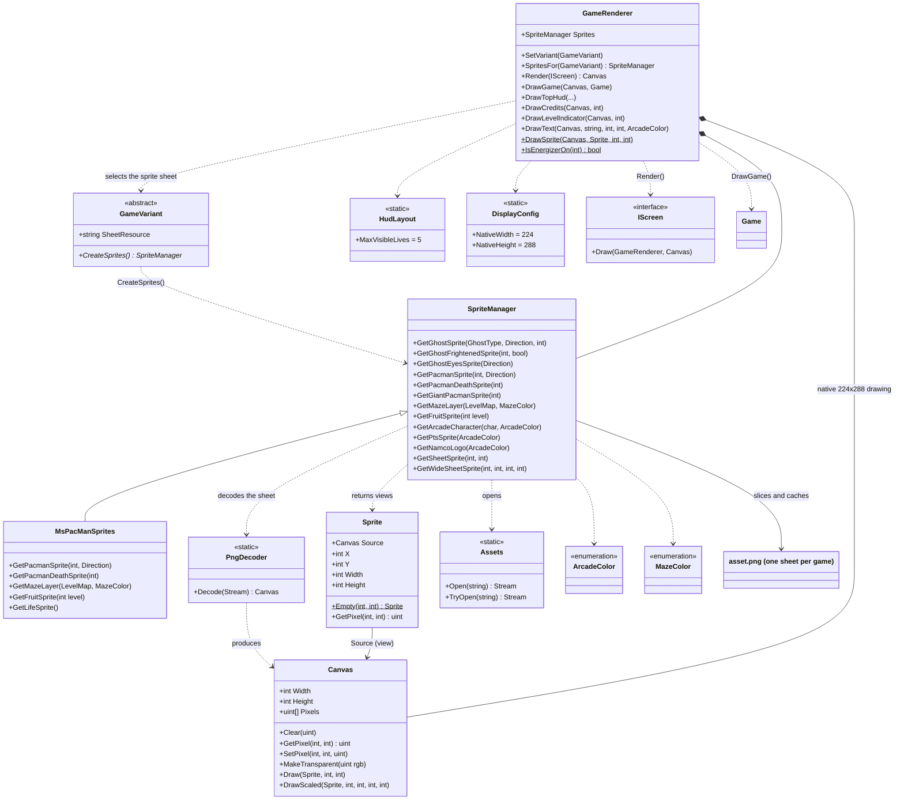

*Figure 6: class diagram: rendering*  
Open full size: [SVG](diagrams/en/06_classes_rendu.svg) · [PNG](diagrams/en/06_classes_rendu.png)

### 2.6 Audio

SoundDirector turns game events into sounds and guarantees that only one background sound plays at a time, through the IAudioEngine interface. MixerAudioEngine decodes the sounds of the chosen game (WavDecoder) when the ScreenManager calls LoadSoundPack, mixes them itself as 48 kHz stereo floats and applies the volume: 24 sounds for Pac-Man, plus the sounds specific to Ms. Pac-Man (fruit bounce, intermissions 2 and 3, the bump of intermission 1). It knows no audio output: SdlAudioOutput, on the host side, calls Read() from the SDL callback to fill the sound card buffer.

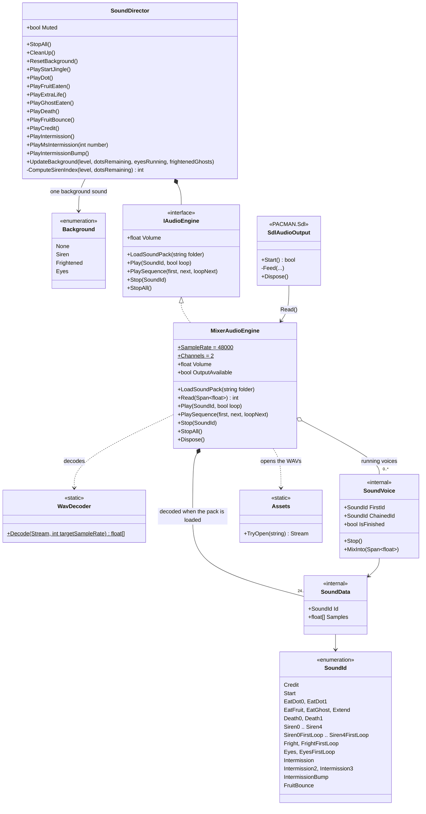

*Figure 7: class diagram: audio*  
Open full size: [SVG](diagrams/en/07_classes_audio.svg) · [PNG](diagrams/en/07_classes_audio.png)

### 2.7 The games (variants)

GameVariant gathers everything that differs between the games; the engine only knows this abstract class. GameVariants lists the games offered by the menu (Pac-Man, then Ms. Pac-Man). PacManVariant describes the original game: a single maze, four classic ghosts, a fixed fruit. MsPacManVariant describes Ms. Pac-Man: six mazes chosen according to the level (MazeIndexForLevel), a single 7-second Scatter phase, ghosts that wander or choose their exit according to their target, the moving fruit MsFruitManager, its own death animation, and its own screens, sprites, sounds and intermissions. The common parameters (speeds, Elroy thresholds, frightened mode) remain those of GameConfig.

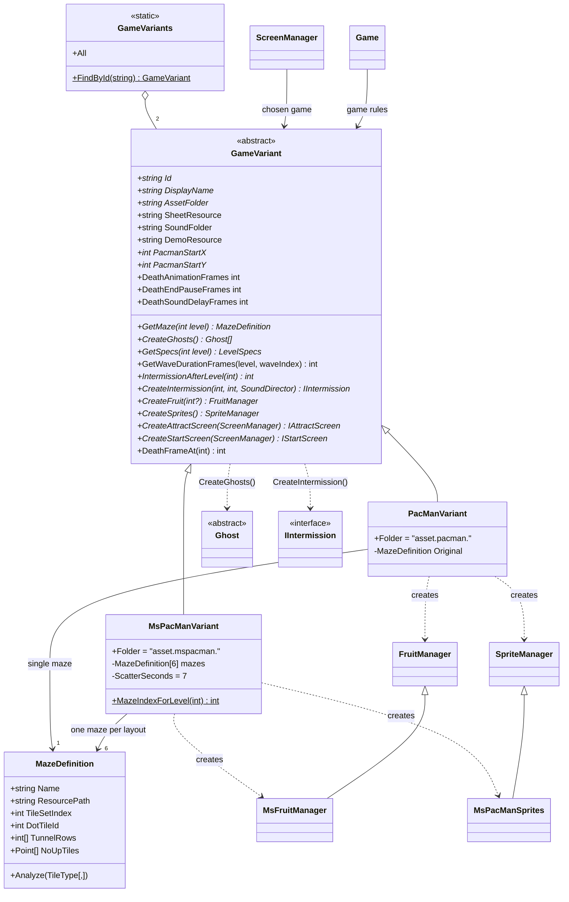

*Figure 8: class diagram: the games (variants)*  
Open full size: [SVG](diagrams/en/08_classes_variantes.svg) · [PNG](diagrams/en/08_classes_variantes.png)

## 3. Sequence diagrams

### 3.1 One game frame at 60 Hz

The SdlHost.Run loop accumulates the elapsed time and calls the logic update as many times as needed, at a fixed step of 1/60 s (catch-up capped at 100 ms), before redrawing. The Canvas produced by GameRenderer is then copied into an SDL texture and presented. Game speed therefore stays identical whatever the machine.

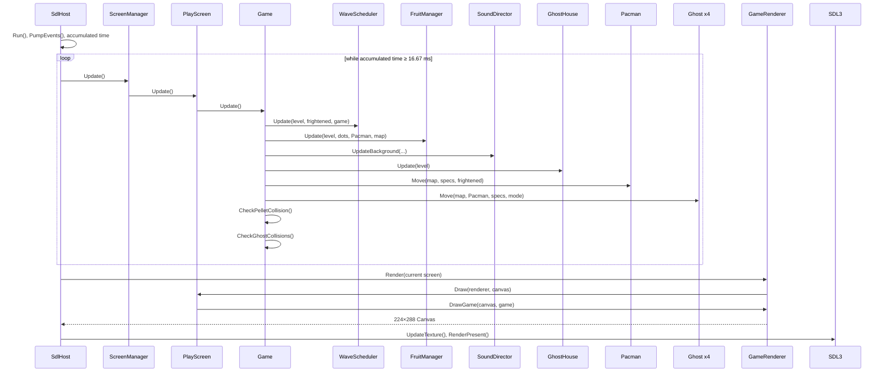

*Figure 9: sequence diagram: one game frame at 60 Hz*  
Open full size: [SVG](diagrams/en/09_sequence_image.svg) · [PNG](diagrams/en/09_sequence_image.png)

### 3.2 From a credit to the start of a game

A credit leads from the attract mode to the start screen; key 1 starts a game and consumes a credit. At the end of GAME OVER, the ScreenManager returns to the start screen if credits remain, otherwise to the attract mode. The screens involved are those of the chosen game (see 3.3 for the game selection): the diagram shows Pac-Man's, and Ms. Pac-Man's play the same role.

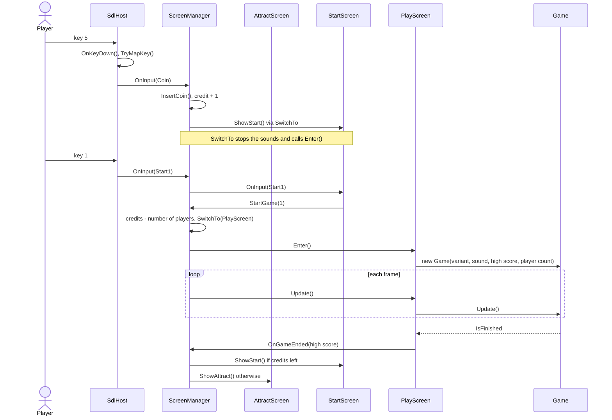

*Figure 10: sequence diagram: from a credit to the start of a game*  
Open full size: [SVG](diagrams/en/10_sequence_credit.svg) · [PNG](diagrams/en/10_sequence_credit.png)

### 3.3 From the menu to the attract mode

At startup, the ScreenManager shows the selection menu. Up and Down move the cursor, 1 or 2 confirms. SelectVariant loads the game's sound pack (only if the game changes), notifies the host, which replaces the GameRenderer's sprite sheet, then starts the chosen game's attract mode. Esc from the attract mode, the demo or the start screen goes back to the menu; credits and high score then restart from zero.

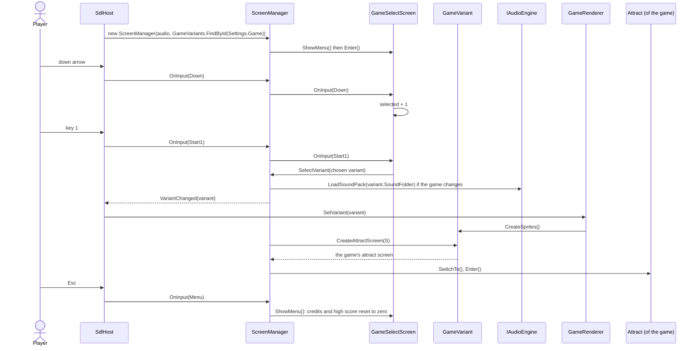

*Figure 11: sequence diagram: from the menu to the attract mode*  
Open full size: [SVG](diagrams/en/11_sequence_choix_jeu.svg) · [PNG](diagrams/en/11_sequence_choix_jeu.png)

## 4. State diagrams common to both games

Each diagram matches an enumeration or a timeline in the code. Durations are in frames at 60 Hz (60 frames = 1 second). This chapter gathers the behaviors shared by Pac-Man and Ms. Pac-Man; the diagrams specific to each game are in chapters 5 and 6.

### 4.1 Screen cycle

The ScreenManager chains the game selection menu, attract mode, demo, start screen and game. At startup the menu is shown, unless a game is forced by `--game` or `Game=` (the program then goes straight to the attract mode). A credit is accepted at any time: it leaves the attract mode or the demo for the start screen, and is simply added to the counter elsewhere. Esc goes back to the menu from the attract mode, the demo or the start screen, never during a game. Demo recording (F9) only exists in Debug builds.

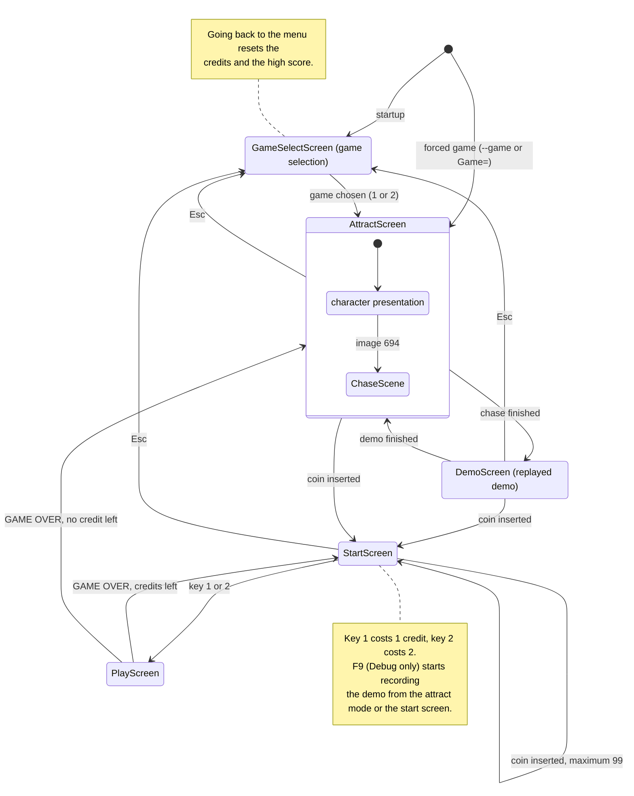

*Figure 12: state diagram: screen cycle*  
Open full size: [SVG](diagrams/en/12_etats_ecrans.svg) · [PNG](diagrams/en/12_etats_ecrans.png)

### 4.2 Game states

Game goes through seven states (GameState). Dying and Victory are split into timed phases. The duration of the death animation and of the pause that follows depends on the game (GameVariant). In demo mode, a death ends after the animation and one second of pause, and a victory ends the demo immediately.

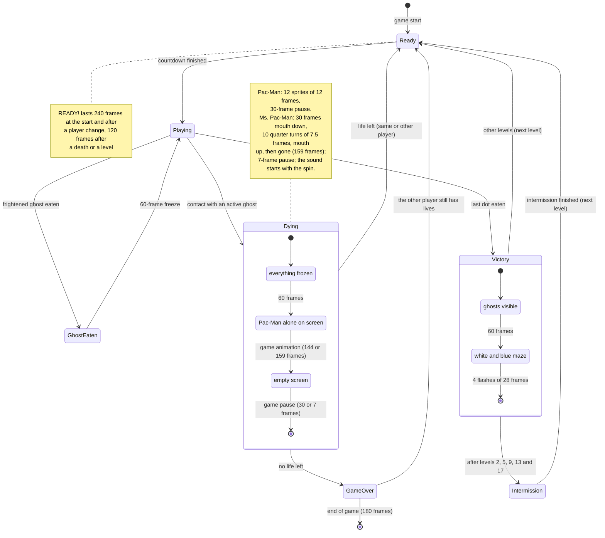

*Figure 13: state diagram: game states*  
Open full size: [SVG](diagrams/en/13_etats_partie.svg) · [PNG](diagrams/en/13_etats_partie.png)

### 4.3 Ghost life cycle

Four phases (GhostPhase). When the ghost is active, two dimensions evolve independently: the wave mode (Scatter or Chase) and the frightened state. When leaving the house, Pac-Man always sends the ghost to the left; Ms. Pac-Man makes it choose left or right according to its target.

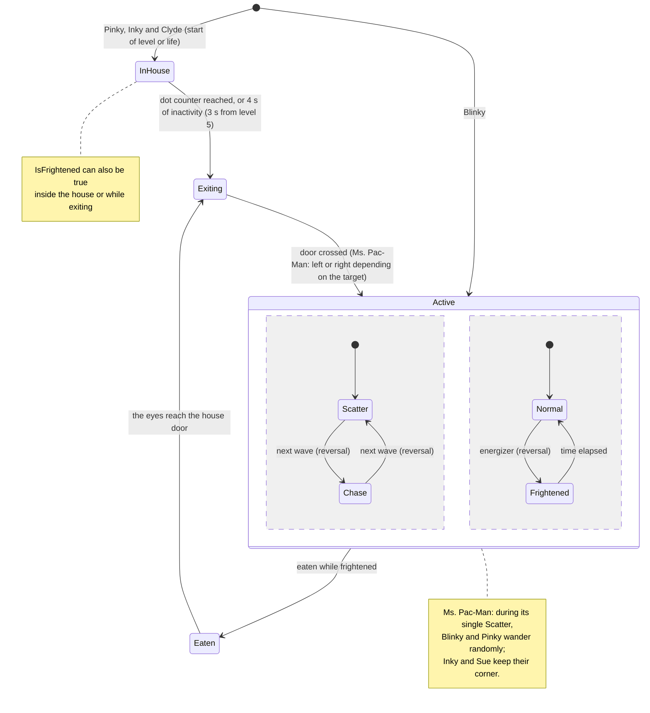

*Figure 14: state diagram: ghost life cycle*  
Open full size: [SVG](diagrams/en/14_etats_fantome.svg) · [PNG](diagrams/en/14_etats_fantome.png)

### 4.4 Background sound

Only one background sound plays at a time, by priority: eyes, then panic, then siren. The siren speeds up in steps when few dots remain.

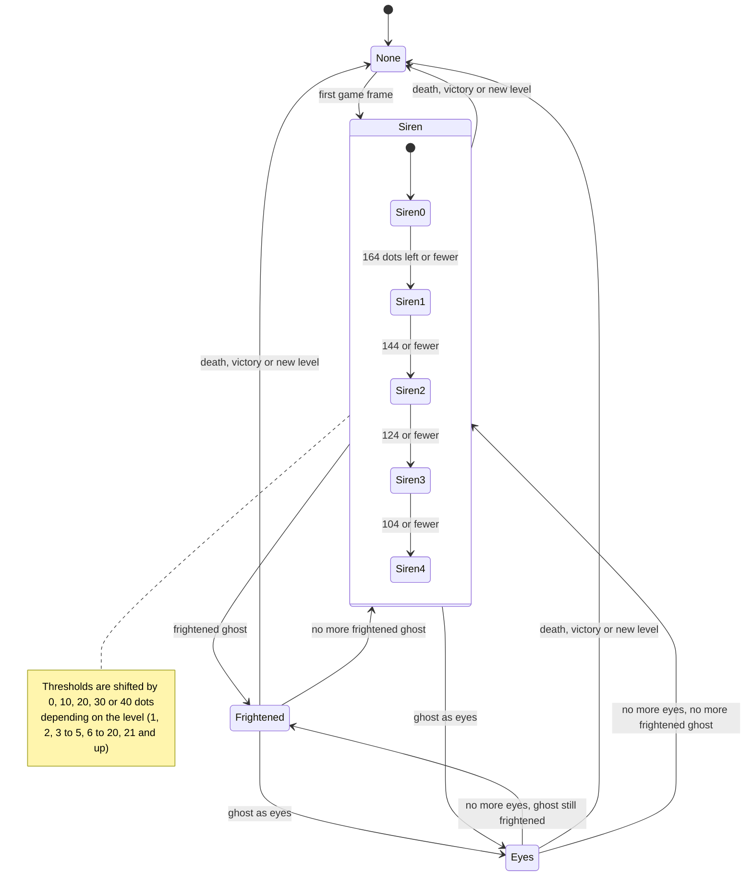

*Figure 15: state diagram: background sound*  
Open full size: [SVG](diagrams/en/15_etats_son.svg) · [PNG](diagrams/en/15_etats_son.png)

### 4.5 Two-player mode

Players alternate after each lost life as long as the other player still has lives. A player with no lives left hands over to the other after their GAME OVER.

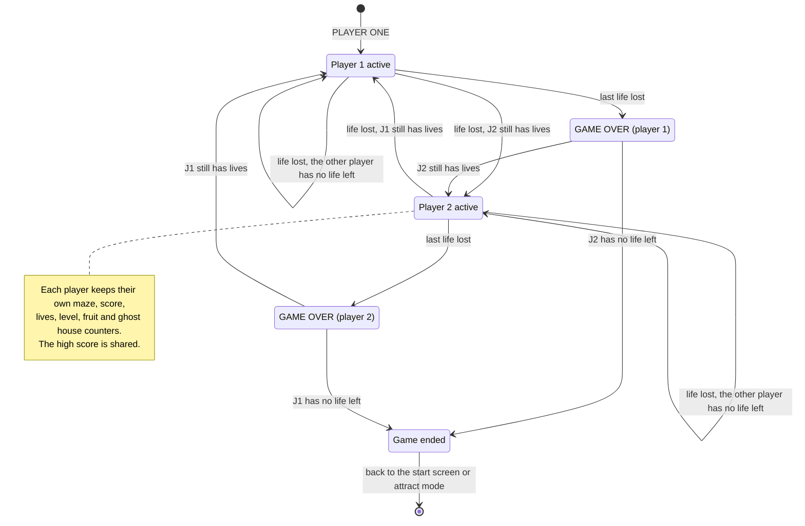

*Figure 16: state diagram: two-player mode*  
Open full size: [SVG](diagrams/en/16_etats_deux_joueurs.svg) · [PNG](diagrams/en/16_etats_deux_joueurs.png)

## 5. Pac-Man (the original game)

This chapter describes what is specific to the 1980 Pac-Man, as supplied by `PacManVariant`: a single maze, the attract mode with the ghost presentation, eight Scatter / Chase waves, a fixed fruit, three intermissions drawn in code, and the classic behavior of the four ghosts.

### 5.1 Pac-Man attract mode

AttractScreen follows the arcade timeline: the table title, then the four ghosts one after another (the sprite, then its name 60 frames later, then its nickname 90 frames after the sprite), the points legend, the logo, and finally the chase scene (ChaseScene). When the fourth ghost is eaten, the demo starts.

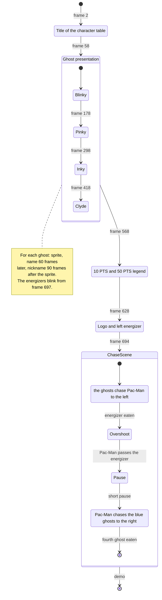

*Figure 17: state diagram: Pac-Man attract mode*  
Open full size: [SVG](diagrams/en/17_etats_attract_pacman.svg) · [PNG](diagrams/en/17_etats_attract_pacman.png)

### 5.2 Pac-Man Scatter / Chase waves

Eight waves alternate; the last one (Chase) lasts until the end of the level. Durations depend on the level (`GameConfig.GetWaveDurationFrames`) and are detailed in 5.7.3.

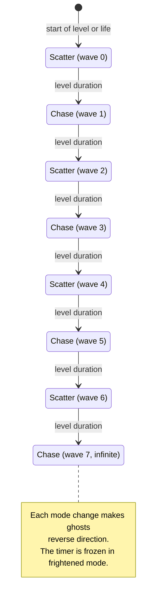

*Figure 18: state diagram: Pac-Man Scatter and Chase waves*  
Open full size: [SVG](diagrams/en/18_etats_vagues_pacman.svg) · [PNG](diagrams/en/18_etats_vagues_pacman.png)

### 5.3 Pac-Man fruit

The Pac-Man fruit stays still, below the ghost house. It appears when 70 and then 170 dots have been eaten, stays between 9 and 10 seconds (random duration) and disappears if it is not eaten. Once eaten, it leaves its score displayed for 2 seconds. A lost life removes the visible fruit, but thresholds already passed are not replayed.

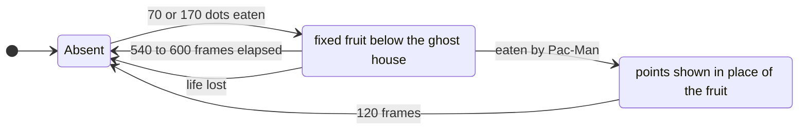

*Figure 19: state diagram: Pac-Man fruit*  
Open full size: [SVG](diagrams/en/19_etats_fruit_pacman.svg) · [PNG](diagrams/en/19_etats_fruit_pacman.png)

### 5.4 Pac-Man intermission 1 (after level 2)

Pac-Man crosses the screen to the left, gradually caught up by Blinky; then a blue Blinky goes back to the right, chased by a giant Pac-Man. The 5-second music, played twice, starts at frame 20.

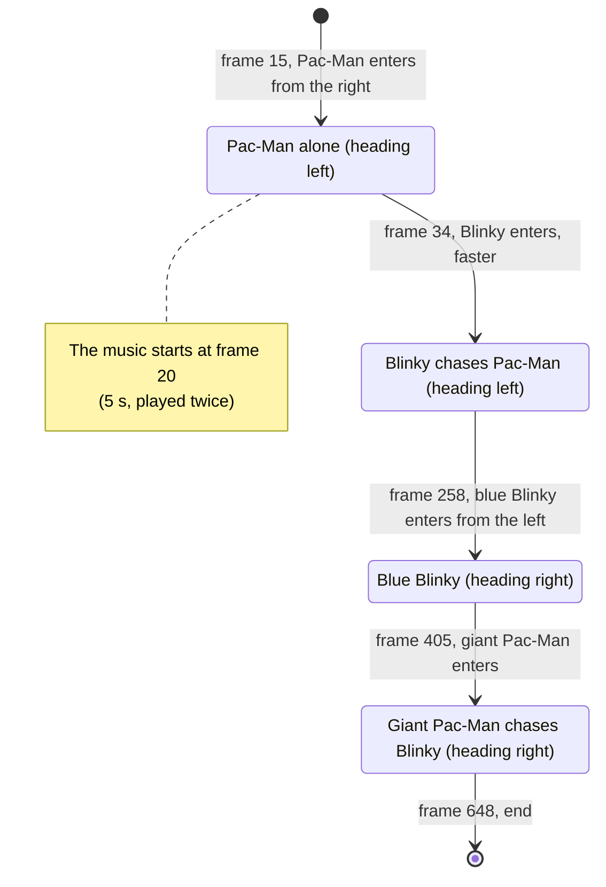

*Figure 20: state diagram: intermission 1*  
Open full size: [SVG](diagrams/en/20_etats_intermission1.svg) · [PNG](diagrams/en/20_etats_intermission1.png)

### 5.5 Pac-Man intermission 2 (after level 5)

Blinky's cloth catches on a nail and stretches through three successive sprites before tearing. The music is cut off sharply at the end of the scene, after the black screen.

```mermaid
stateDiagram-v2
  [*] --> PacmanAlone : frame 16, Pac-Man enters from the right
  PacmanAlone --> Chase : frame 104, Blinky enters
  Chase --> Snagged : frame 190, the cloth catches on the nail
  Snagged --> Torn : frame 326, the cloth tears
  Torn --> LooksDown : frame 385, Blinky looks down
  LooksDown --> Black : frame 503, black screen
  Black --> [*] : frame 511, end
  state "Pac-Man alone" as PacmanAlone
  state "Blinky chases Pac-Man" as Chase
  state "Stretched cloth (3 sprites by step)" as Snagged
  state "Torn Blinky, eyes up" as Torn
  state "Torn Blinky, eyes down" as LooksDown
  state "Everything black" as Black
```

*Figure 21: state diagram: intermission 2*  
Open full size: [SVG](diagrams/en/21_etats_intermission2.svg) · [PNG](diagrams/en/21_etats_intermission2.png)

### 5.6 Pac-Man intermission 3 (after levels 9, 13 and 17)

Pac-Man, chased by Blinky with his cloth sewn back, exits to the left; the screen stays empty for a moment, then Blinky, undressed, crawls to the right dragging his cloth.

```mermaid
stateDiagram-v2
  [*] --> PacmanAlone : frame 15, Pac-Man enters from the right
  PacmanAlone --> Chase : frame 56, Blinky enters, cloth sewn back
  Chase --> EmptyScreen : frame 235, both gone off to the left
  EmptyScreen --> Crawl : frame 307, Blinky enters from the left
  Crawl --> [*] : frame 533, end
  state "Pac-Man alone" as PacmanAlone
  state "Blinky chases Pac-Man (heading left)" as Chase
  state "Empty screen" as EmptyScreen
  state "Blinky crawls dragging his cloth (heading right)" as Crawl
```

*Figure 22: state diagram: intermission 3*  
Open full size: [SVG](diagrams/en/22_etats_intermission3.svg) · [PNG](diagrams/en/22_etats_intermission3.png)

### 5.7 Analysis of ghost behavior

The four ghosts follow the same movement rule; only the tile they aim for changes, depending on their state and personality. Ms. Pac-Man keeps this mechanism and changes it in a few places, described in chapter 6.

#### 5.7.1 How a ghost chooses its direction

At each tile center, a ghost picks the exit whose next tile is closest to its target, using squared Euclidean distance. There is no pathfinding and no memory: the decision is local, which produces the predictable trajectories of the arcade.

- Candidate directions are tested in the order Up, Left, Down, Right; in case of a tie, the first one wins.
- Reversing is forbidden, except for a reversal imposed by a mode change.
- Walls and the ghost house door are excluded (only eyes may cross the door).
- In Pac-Man, at the four intersections (12,14), (15,14), (12,26) and (15,26), an active ghost cannot turn upward; Ms. Pac-Man has its own intersections, depending on the maze (6.1).

#### 5.7.2 Target by state

| State | Target | Note |
| --- | --- | --- |
| Scatter | The ghost's own corner | They loop around a block |
| Chase | Tile computed by each ghost (5.7.4) | The only difference in personality |
| Frightened | None: pseudo-random choice | Order Up, Right, Down, Left, fixed seed |
| Eaten (eyes) | Tile (13,14), in front of the house | Speed 2 px per frame |

#### 5.7.3 Alternation of Scatter and Chase

A scheduler of 8 waves alternates Scatter (even waves) and Chase (odd waves), then stays in Chase forever at the 8th. The higher the level, the shorter the Scatter phase, until it becomes a mere direction reversal.

| Wave | Level 1 | Levels 2 to 4 | Levels 5 and up |
| --- | --- | --- | --- |
| 1 Scatter | 7 s | 7 s | 5 s |
| 2 Chase | 20 s | 20 s | 20 s |
| 3 Scatter | 7 s | 7 s | 5 s |
| 4 Chase | 20 s | 20 s | 20 s |
| 5 Scatter | 5 s | 5 s | 5 s |
| 6 Chase | 20 s | 1033 s | 1037 s |
| 7 Scatter | 5 s | 1 frame | 1 frame |
| 8 Chase | infinite | infinite | infinite |

Three rules complete this table:

- The timer is frozen while ghosts are frightened.
- At every wave change, all ghosts receive a request to reverse direction: this is the only visible signal of a mode change.
- A ghost leaving the house takes the current mode; those still inside keep the reversal request and therefore exit to the right instead of the left.

An energizer also requests the reversal, even when the level's frightened duration is zero (levels 17, 19, 20 and beyond).

#### 5.7.4 What sets the four ghosts apart

Blinky aims at Pac-Man; the others aim at a computed point meant to cut off or avoid his path. This variety is what makes the pincer chase work.

| Ghost | Chase target | Scatter corner | Role |
| --- | --- | --- | --- |
| Blinky (red) | Pac-Man's tile | Top right, (25,0) | Direct pursuer, speeds up (Elroy) |
| Pinky (pink) | 4 tiles ahead of Pac-Man | Top left, (2,0) | Ambush |
| Inky (blue) | Mirror of Blinky through a point 2 tiles ahead of Pac-Man | Bottom right, (27,34) | Unpredictable, depends on Blinky |
| Clyde (orange) | Pac-Man if 8 or more tiles away, otherwise his own corner | Bottom left, (0,34) | Chases from afar, flees up close |

**Blinky** computes nothing: he aims at the tile Pac-Man occupies and follows him closely. He gets faster when few dots remain (Cruise Elroy, below) and does not go back to his corner while in Elroy.

**Pinky** aims 4 tiles ahead of Pac-Man in his direction. When Pac-Man goes up, the target is also shifted 4 tiles to the left: this is the arcade's overflow bug, deliberately reproduced. Turning around in front of Pinky often makes him head the other way.

**Inky** is the most complex: take the point 2 tiles ahead of Pac-Man (with the same 2-tile shift to the left when he goes up), draw the vector from Blinky to that point, then double it. Inky therefore ends up on the other side of Pac-Man from Blinky; alone he is harmless, but combined with Blinky he closes off the exits.

**Clyde** alternates: if he is 8 or more tiles from Pac-Man (squared distance of 64 or more), he targets him like Blinky; as soon as he gets close, he targets his bottom-left corner and moves away. He ends up circling that corner without ever cornering the player.

#### 5.7.5 Cruise Elroy

When few dots remain, Blinky speeds up in two steps and chases Pac-Man even during Scatter phases. The threshold depends on the level; the second step is at half of the first.

| Levels | Dots remaining (step 1 / step 2) | Speed step 1 / step 2 |
| --- | --- | --- |
| 1 | 20 / 10 | 0.80 / 0.85 |
| 2 | 30 / 15 | 0.90 / 0.95 |
| 3 to 4 | 40 / 20 | 0.90 / 0.95 |
| 5 | 40 / 20 | 1.00 / 1.05 |
| 6 to 8 | 50 / 25 | 1.00 / 1.05 |
| 9 to 11 | 60 / 30 | 1.00 / 1.05 |
| 12 to 14 | 80 / 40 | 1.00 / 1.05 |
| 15 to 18 | 100 / 50 | 1.00 / 1.05 |
| 19 and up | 120 / 60 | 1.00 / 1.05 |

After Pac-Man dies, Elroy is suspended until Clyde leaves the house.

#### 5.7.6 Leaving the ghost house

Ghosts do not leave together: each waits until Pac-Man has eaten enough dots. If Pac-Man stops eating, a timer forces the first waiting ghost out.

| Ghost | Level 1 | Level 2 | Level 3 and up |
| --- | --- | --- | --- |
| Blinky | Outside from the start | Outside | Outside |
| Pinky | 0 dots | 0 | 0 |
| Inky | 30 dots | 0 | 0 |
| Clyde | 60 dots | 50 | 0 |

After a death, a global counter replaces these thresholds (Pinky at 7, Inky at 17, Clyde at 32 dots). The forced-exit timer is 4 s on levels 1 to 4 and 3 s afterwards.

#### 5.7.7 Key takeaways

- The danger comes from the combination: Blinky pushes, Pinky cuts off, Inky closes the other side and Clyde eases the pressure up close.
- Scatter is not a break: it disperses the ghosts to break the pincer, and barely lasts at high levels.
- Direction reversals, not colors or sounds, announce a mode change.
- The "faulty" behaviors (Pinky's and Inky's upward shift, the no-Up intersections) are those of the original arcade and are kept.
- Ms. Pac-Man makes the ghosts less predictable: during its single Scatter, Blinky and Pinky wander randomly, and when leaving the house each one picks left or right according to its target.

## 6. Ms. Pac-Man (variant)

This chapter describes what is specific to Ms. Pac-Man, as supplied by `MsPacManVariant`. The engine, the speeds, the Elroy thresholds, the frightened duration and the ghost house counters are those of Pac-Man (chapters 4 and 5); the mazes, the waves, the ghosts in Scatter and when leaving the house, the fruit, the death, the attract mode and the intermissions are different.

### 6.1 What changes compared with Pac-Man

Ms. Pac-Man reuses Pac-Man's speeds, Elroy thresholds, frightened duration and ghost house counters. The differences concern the waves, the Scatter targets, leaving the house, the fruit and the mazes.

| Topic | Pac-Man | Ms. Pac-Man |
| --- | --- | --- |
| Waves | 8 waves, durations depending on the level | A single 7-second Scatter at the start of the level, then Chase until the end |
| Scatter targets | Each ghost's corner | Blinky and Pinky wander randomly (except Blinky in Elroy); Inky and Sue keep their corner |
| Fourth ghost | Clyde | Sue, same behavior as Clyde |
| Upward shift of Pinky and Inky | Yes (arcade bug) | No |
| Leaving the house | Always to the left (to the right if a reversal is pending) | Left or right according to the target (left if frightened) |
| Fruit | Fixed below the house, at 70 and 170 dots, 9 to 10 s | Moving, at 64 and 176 dots, enters through a tunnel, laps the house and leaves; the second is ignored if the first is present |
| Mazes | 1 | 6, depending on the level (1-2, 3-5, 6-9, 10-13, then color variants in blocks of 4 levels) |
| Intersections with no upward turn | (12,14), (15,14), (12,26), (15,26) | Mazes 1, 3 and 5: (9,14), (18,14), (9,26), (18,26); mazes 4 and 6: (12,14), (15,14), (12,23), (15,23); maze 2: none |
| Death | 144-frame animation, 30-frame pause | 159-frame animation (900° spin), 7-frame pause |

### 6.2 Mazes by level

Ms. Pac-Man has six mazes (`MazeIndexForLevel`). The first four follow one another on levels 1-2, 3-5, 6-9 and 10-13; then mazes 5 and 6, color variants of mazes 3 and 4, alternate in blocks of 4 levels. The tunnels of each maze are detected automatically when the map is loaded (`MazeDefinition.Analyze`), along with their slow zones.

```mermaid
stateDiagram-v2
  [*] --> L1 : level 1
  state "Maze 1 (levels 1 and 2)" as L1
  state "Maze 2 (levels 3 to 5)" as L2
  state "Maze 3 (levels 6 to 9)" as L3
  state "Maze 4 (levels 10 to 13)" as L4
  state "Maze 5 (layout of maze 3)" as L5
  state "Maze 6 (layout of maze 4)" as L6
  L1 --> L2 : level 3
  L2 --> L3 : level 6
  L3 --> L4 : level 10
  L4 --> L5 : level 14
  L5 --> L6 : 4 levels later
  L6 --> L5 : 4 levels later
```

*Figure 23: state diagram: Ms. Pac-Man mazes by level*  
Open full size: [SVG](diagrams/en/23_etats_labyrinthes_ms.svg) · [PNG](diagrams/en/23_etats_labyrinthes_ms.png)

| Maze | Levels | Intersections where an active ghost cannot turn upward |
| --- | --- | --- |
| 1 | 1 and 2 | (9,14), (18,14), (9,26), (18,26) |
| 2 | 3 to 5 | none |
| 3 | 6 to 9 | (9,14), (18,14), (9,26), (18,26) |
| 4 | 10 to 13 | (12,14), (15,14), (12,23), (15,23) |
| 5 | 14 to 17, 22 to 25, and so on | (9,14), (18,14), (9,26), (18,26) |
| 6 | 18 to 21, 26 to 29, and so on | (12,14), (15,14), (12,23), (15,23) |

### 6.3 Ms. Pac-Man attract mode

MsAttractScreen shows the title in a marquee (96 running lights), then presents Blinky, Pinky, Inky and Sue: the name appears, the ghost enters from the right below the marquee, goes all the way left, pauses 4 frames at the corner and climbs to stack up left of the marquee. Then come "STARRING MS PAC-MAN" and the entrance of Ms. Pac-Man, then the demo. The timeline is measured on the arcade.

```mermaid
stateDiagram-v2
  [*] --> Title : frame 5
  state "Title, marquee, Midway logo" as Title
  state "WITH" as With
  state "Ghost presentation" as Ghosts {
    [*] --> Blinky : name at frame 62
    Blinky --> Pinky : name at frame 334
    Pinky --> Inky : name at frame 590
    Inky --> Sue : name at frame 830
    Blinky : enters at frame 73
    Pinky : enters at frame 345
    Inky : enters at frame 601
    Sue : enters at frame 841
  }
  state "STARRING MS PAC-MAN" as Starring
  state "Ms. Pac-Man enters from the right and stops below the marquee" as Entrance
  Title --> With : frame 61
  With --> Ghosts : frame 62
  Ghosts --> Starring : frame 1054
  Starring --> Entrance : frame 1066
  Entrance --> [*] : frame 1304, demo
  note right of Ghosts
    Each ghost enters from the right below the marquee,
    goes left, stops 4 frames at the corner,
    then climbs to stack up. Its name stays on screen
    until the next name.
  end note
```

*Figure 24: state diagram: Ms. Pac-Man attract mode*  
Open full size: [SVG](diagrams/en/24_etats_attract_ms.svg) · [PNG](diagrams/en/24_etats_attract_ms.png)

### 6.4 Ms. Pac-Man Scatter / Chase waves

Ms. Pac-Man has a single Scatter phase, 7 seconds long, at the start of each level and each life; the ghosts then stay in Chase until the end of the level. `MsPacManVariant.GetWaveDurationFrames` returns 420 frames for wave 0 and an infinite duration for the next one; the WaveScheduler is the same as for Pac-Man.

```mermaid
stateDiagram-v2
  direction LR
  [*] --> S0 : start of level or life
  state "Scatter (wave 0)" as S0
  state "Chase (wave 1, infinite)" as C1
  S0 --> C1 : 420 frames (7 s), ghosts reverse
  C1 --> [*] : end of level or life lost
  note right of S0
    The timer is frozen in frightened mode.
  end note
```

*Figure 25: state diagram: Ms. Pac-Man Scatter and Chase waves*  
Open full size: [SVG](diagrams/en/25_etats_vagues_ms.svg) · [PNG](diagrams/en/25_etats_vagues_ms.png)

### 6.5 Ms. Pac-Man ghosts

The ghosts keep the common life cycle (4.3). Two settings applied by `MsPacManVariant.CreateGhosts` change their behavior. During the single Scatter, Blinky and Pinky pick their turns at random (`WandersInScatter`) instead of heading for their corner, except Blinky in Cruise Elroy, who chases Ms. Pac-Man; Inky and Sue aim at their corner. When leaving the house (`ExitsTowardTarget`), the ghost leaves on the side closest to its target, or at random if it is wandering; if it is frightened, it leaves as in Pac-Man. The eyes of an eaten ghost come back out as soon as they reach the door, without waiting for a counter.

```mermaid
stateDiagram-v2
  [*] --> InHouse : Pinky, Inky and Sue
  [*] --> Active : Blinky
  InHouse --> Exiting : dot counter or timer, as in Pac-Man
  Exiting --> Active : door crossed, direction chosen
  note left of Exiting
    Direction when leaving the house
    - frightened, left as in Pac-Man
    - Scatter and wandering ghost, left or right at random
    - otherwise, side closest to the target, left on a tie
  end note
  state Active {
    [*] --> Scatter
    state "Scatter (7 s)" as Scatter {
      Wander : Blinky and Pinky, random turns
      Corner : Inky and Sue, maze corner
      Elroy : Blinky in Cruise Elroy, chases Ms. Pac-Man
    }
    Scatter --> Chase : 7 s elapsed (reversal)
    Chase : Pac-Man chase targets, without the upward shift
  }
  Active --> Eaten : eaten while frightened
  Eaten --> Exiting : the eyes reach the door, comes back out at once
```

*Figure 26: state diagram: Ms. Pac-Man ghosts*  
Open full size: [SVG](diagrams/en/26_etats_fantome_ms.svg) · [PNG](diagrams/en/26_etats_fantome_ms.png)

### 6.6 Path of the Ms. Pac-Man fruit

The Ms. Pac-Man fruit does not stay still: it enters through a randomly chosen tunnel, reaches the rectangle of corridors around the ghost house (deduced from the house door, hence specific to each maze), makes a full clockwise lap around it without ever reversing, then leaves through another tunnel by the shortest path. It moves 0.5 pixel per frame (one tile every 16 frames) and bounces at the same rhythm; the whole trip takes about 14 s. It appears at 64 and 176 dots eaten; the second fruit is ignored if the first is still on screen. It never disappears on a timer: only when it leaves the maze or when Ms. Pac-Man eats it.

```mermaid
stateDiagram-v2
  [*] --> Approach : 64 or 176 dots eaten, no fruit on screen
  state "Approach: enters through a tunnel, reaches the loop around the house" as Approach
  state "Lap: one full lap, clockwise, no reversal" as Lap
  state "Leave: shortest path to another tunnel" as Leave
  state "Eaten: score shown for 2 s" as Eaten
  Approach --> Lap : reaches a corridor of the loop
  Approach --> Leave : no complete loop in this maze
  Lap --> Leave : lap finished, back at the arrival tile
  Leave --> [*] : leaves the screen through the tunnel
  Approach --> Eaten : touched by Ms. Pac-Man
  Lap --> Eaten : touched by Ms. Pac-Man
  Leave --> Eaten : touched by Ms. Pac-Man
  Eaten --> [*]
```

*Figure 27: state diagram: path of the Ms. Pac-Man fruit*  
Open full size: [SVG](diagrams/en/27_etats_fruit_ms.svg) · [PNG](diagrams/en/27_etats_fruit_ms.png)

### 6.7 Death of Ms. Pac-Man

On contact with a ghost, all sounds are cut and the game freezes for one second, as for Pac-Man. Ms. Pac-Man then stays 30 frames with her mouth pointing down, then spins clockwise: 10 quarter turns (900°), one every 7.5 frames, during which the death sound is played. She stops with her mouth pointing up, stays so for 62 frames, then disappears; the next life starts 7 frames later. The animation lasts 159 frames (`DeathAnimationFrames`), against 144 for Pac-Man.

```mermaid
stateDiagram-v2
  [*] --> Freeze : contact with a ghost, sounds cut
  state "Freeze, everything frozen" as Freeze
  state "Mouth down" as Down
  state "Clockwise spin, 10 quarter turns" as Spin
  state "Mouth up" as Up
  state "Gone" as Gone
  Freeze --> Down : 60 frames
  Down --> Spin : 30 frames, the death sound starts
  Spin --> Up : 67 frames (one quarter turn every 7.5 frames)
  Up --> Gone : 62 frames
  Gone --> [*] : 7 frames
```

*Figure 28: state diagram: death of Ms. Pac-Man*  
Open full size: [SVG](diagrams/en/28_etats_mort_ms.svg) · [PNG](diagrams/en/28_etats_mort_ms.png)

### 6.8 Ms. Pac-Man intermission 1: "They Meet" (after level 2)

The three Ms. Pac-Man intermissions are played by a single class, MsIntermissionScene: each character follows a track of positions recorded frame by frame on the arcade (MsIntermissionData). Each act starts with a clapperboard bearing its number (arm open, half closed at frame 47, closed at frame 53, open again at frame 59, clapperboard shown until frame 86) and with its title; the act's music starts at frame 1. In act 1, Pac-Man and Ms. Pac-Man first cross the screen in opposite directions, each chased by a ghost; they then come back toward each other on the same row, go up together at the last moment, and the two ghosts collide. A heart appears above the couple. The scene lasts 611 frames.

```mermaid
stateDiagram-v2
  [*] --> Clapper : frame 1, music of act 1
  state "Clapperboard 1 and title THEY MEET (title until frame 55)" as Clapper
  state "Crossing: Pac-Man at the top heading right, Ms. Pac-Man at the bottom heading left" as Crossing
  state "Inky chases Pac-Man (frame 145), Pinky chases Ms. Pac-Man (frame 149)" as Pursuit
  state "Empty screen" as Empty
  state "Meeting: Pac-Man enters from the right, Ms. Pac-Man from the left, same row" as Meeting
  state "Inky (frame 402) and Pinky (frame 405) enter behind them" as Ghosts
  state "Pac-Man and Ms. Pac-Man go up side by side" as Rise
  state "Inky and Pinky collide and bounce back (sound effect)" as Bump
  state "The ghosts are gone, a heart appears above the couple" as Heart
  Clapper --> Crossing : frame 101
  Crossing --> Pursuit : frame 145
  Pursuit --> Empty : frame 352, all gone
  Empty --> Meeting : frame 355
  Meeting --> Ghosts : frame 402
  Ghosts --> Rise : frame 459
  Rise --> Bump : frame 487
  Bump --> Heart : frame 514
  Heart --> [*] : frame 611, end
```

*Figure 29: state diagram: Ms. Pac-Man intermission 1 (They Meet)*  
Open full size: [SVG](diagrams/en/29_etats_intermission1_ms.svg) · [PNG](diagrams/en/29_etats_intermission1_ms.png)

### 6.9 Ms. Pac-Man intermission 2: "The Chase" (after level 5)

After the clapperboard, Pac-Man and Ms. Pac-Man chase each other across the screen: three crossings at different heights, changing direction and pursuer, then a final very fast round trip. The scene lasts 1284 frames, the longest of the three; the screen stays empty between crossings.

```mermaid
stateDiagram-v2
  [*] --> Clapper : frame 1, music of act 2
  state "Clapperboard 2 and title THE CHASE (title until frame 56)" as Clapper
  state "Crossing 1, top, heading right: Pac-Man in front, Ms. Pac-Man behind" as T1
  state "Crossing 2, bottom, heading left: Ms. Pac-Man in front, Pac-Man behind" as T2
  state "Crossing 3, middle, heading right: Pac-Man in front, Ms. Pac-Man behind" as T3
  state "Fast run to the left, top: Ms. Pac-Man in front, Pac-Man behind" as T4
  state "Fast run back to the right, bottom: Pac-Man in front, Ms. Pac-Man behind" as T5
  state "Empty screen until the music ends" as End
  Clapper --> T1 : frame 255
  T1 --> T2 : frame 511 (empty screen since frame 366)
  T2 --> T3 : frame 767 (empty screen since frame 620)
  T3 --> T4 : frame 1021 (empty screen since frame 873)
  T4 --> T5 : around frame 1070
  T5 --> End : frame 1125
  End --> [*] : frame 1284, end
```

*Figure 30: state diagram: Ms. Pac-Man intermission 2 (The Chase)*  
Open full size: [SVG](diagrams/en/30_etats_intermission2_ms.svg) · [PNG](diagrams/en/30_etats_intermission2_ms.png)

### 6.10 Ms. Pac-Man intermission 3: "Junior" (after levels 9, 13 and 17)

Pac-Man and Ms. Pac-Man wait at the bottom left. A stork crosses the screen from right to left carrying a bundle and drops it in flight; the bundle falls diagonally, bounces up to the couple and opens to reveal a baby Pac-Man. The bundle stays visible from its entrance until it changes. The scene lasts 504 frames.

```mermaid
stateDiagram-v2
  [*] --> Clapper : frame 1, music of act 3
  state "Clapperboard 3 and title JUNIOR (title until frame 55)" as Clapper
  state "Pac-Man and Ms. Pac-Man wait at the bottom left" as Wait
  state "The stork enters from the right (frame 102) with the bundle (frame 115)" as Stork
  state "The bundle is dropped, falls diagonally and bounces" as Fall
  state "The bundle comes to rest near the couple" as Rest
  state "The bundle opens: baby Pac-Man" as Baby
  state "Empty screen" as Empty
  Clapper --> Wait : frame 91
  Wait --> Stork : frame 102
  Stork --> Fall : frame 221
  Fall --> Rest : frame 378
  Rest --> Baby : frame 384
  Baby --> Empty : frame 446 (the stork left at frame 396)
  Empty --> [*] : frame 504, end
```

*Figure 31: state diagram: Ms. Pac-Man intermission 3 (Junior)*  
Open full size: [SVG](diagrams/en/31_etats_intermission3_ms.svg) · [PNG](diagrams/en/31_etats_intermission3_ms.png)
