# Pac-Man et Ms Pac-Man (C#, .NET 10, SDL3) : UML et diagrammes d'états

Ce document décrit l'architecture finale du jeu en 31 diagrammes : un diagramme de paquets, 7 diagrammes de classes, 3 diagrammes de séquence et 20 diagrammes d'états, tous établis à partir du code source. Le programme propose deux jeux, Pac-Man et Ms Pac-Man, qui partagent le même moteur : tout ce qui change d'un jeu à l'autre est regroupé dans une classe `GameVariant`. Les chapitres 1 à 4 décrivent ce qui est commun aux deux jeux ; le chapitre 5 est consacré au Pac-Man d'origine et le chapitre 6 à la variante Ms Pac-Man. Le jeu est découpé en deux projets : la bibliothèque `PACMAN.Core`, indépendante de toute plateforme (règles, rendu logiciel, mixage audio), et l'hôte `PACMAN.Sdl`, qui ouvre la fenêtre, lit le clavier et la manette et joue le son avec SDL3 sous Windows et Linux. Les diagrammes sont écrits en [Mermaid](https://mermaid.js.org) et s'affichent directement dans les visionneuses Markdown qui le gèrent (GitHub, GitLab, VS Code avec une extension, Obsidian, etc.) ; chacun est aussi fourni en SVG et en PNG. Dans la version PDF, les grands diagrammes sont placés sur des pages au format paysage.

## 1. Vue d'ensemble

Le projet `PACMAN.Sdl` (Program, SdlHost, SdlAudioOutput) est la seule partie qui connaît SDL3. Il pilote la bibliothèque `PACMAN.Core`, dont les sept dossiers forment trois niveaux : la plateforme (Platform) et les écrans (Screens) pilotent le jeu (Game, Ghosts, Maze), qui s'appuie sur le rendu (Graphics) et l'audio (Audio). Game et Ghosts sont étroitement liés : Game crée les quatre fantômes, et un fantôme lit Pacman et LevelSpecs, définis dans Game. Le rendu et l'audio ne dépendent d'aucune API graphique ou sonore : GameRenderer dessine dans un Canvas (tableau de pixels) et MixerAudioEngine produit des échantillons que l'hôte envoie à la carte son. Les deux jeux (Pac-Man et Ms Pac-Man) se distinguent uniquement par leur `GameVariant`, qui fournit les labyrinthes, les fantômes, le fruit, les sprites, les sons, les écrans et les intermissions ; le moteur n'a aucune connaissance directe d'un jeu en particulier.

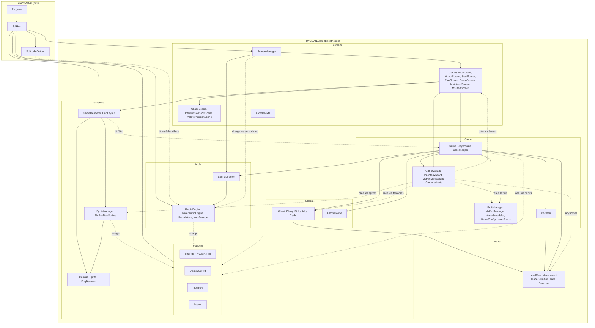

*Figure 1 : diagramme de paquets : l'hôte PACMAN.Sdl, les sept dossiers de PACMAN.Core et leurs dépendances*  
Ouvrir en grand : [SVG](diagrams/fr/01_paquets.svg) · [PNG](diagrams/fr/01_paquets.png)

| Dossier | Rôle | Classes principales |
| --- | --- | --- |
| PACMAN.Sdl (projet) | Hôte SDL3 : fenêtre, plein écran, clavier, manette, boucle à pas fixe, sortie audio | Program, SdlHost, SdlAudioOutput |
| Platform | Réglages `PACMAN.ini` et option `--game`, touches abstraites, accès aux ressources embarquées | Settings, DisplayConfig, InputKey, Assets |
| Screens | Choix du jeu, enchaînement des écrans, crédits, intermissions | ScreenManager, IScreen, GameSelectScreen, AttractScreen, StartScreen, PlayScreen, DemoScreen, Intermission1/2/3Scene, MsAttractScreen, MsStartScreen, MsIntermissionScene |
| Game | Règles et état d'une partie, différences entre les jeux | Game, PlayerState, ScoreKeeper, FruitManager, MsFruitManager, WaveScheduler, Pacman, GameConfig, GameVariant, PacManVariant, MsPacManVariant, GameVariants |
| Ghosts | Comportement des fantômes et du nid | Ghost, Blinky, Pinky, Inky, Clyde, GhostHouse |
| Maze | Labyrinthes, cases, directions | LevelMap, MazeLayout, MazeDefinition, Tiles, Direction |
| Graphics | Dessin logiciel à la résolution de l'arcade (224×288) | GameRenderer, SpriteManager, MsPacManSprites, HudLayout, Canvas, Sprite, PngDecoder |
| Audio | Sons, mixage logiciel et volume | SoundDirector, IAudioEngine, MixerAudioEngine, SoundVoice, WavDecoder |

## 2. Diagrammes de classes

Les membres affichés sont les plus significatifs, pas la liste complète. Les relations suivent l'UML : flèche creuse pour l'héritage ou l'implémentation d'une interface, losange plein pour la composition, losange creux pour l'agrégation, trait pointillé pour une dépendance.

### 2.1 Écrans et navigation

Program crée le SdlHost, qui possède un ScreenManager. Celui-ci garde l'écran courant derrière l'interface IScreen. Au lancement, le ScreenManager affiche le menu de choix du jeu (GameSelectScreen), sauf si un jeu est imposé par l'option `--game` ou par `Game=` dans `PACMAN.ini`. Le jeu choisi (GameVariant) crée ensuite ses propres écrans de présentation et de démarrage, derrière les interfaces IAttractScreen et IStartScreen. Les crédits, le high score et le son traversent les écrans : ils vivent dans le ScreenManager. Le SdlHost traduit les touches du clavier et de la manette en InputKey, ce qui garde les écrans indépendants de SDL.

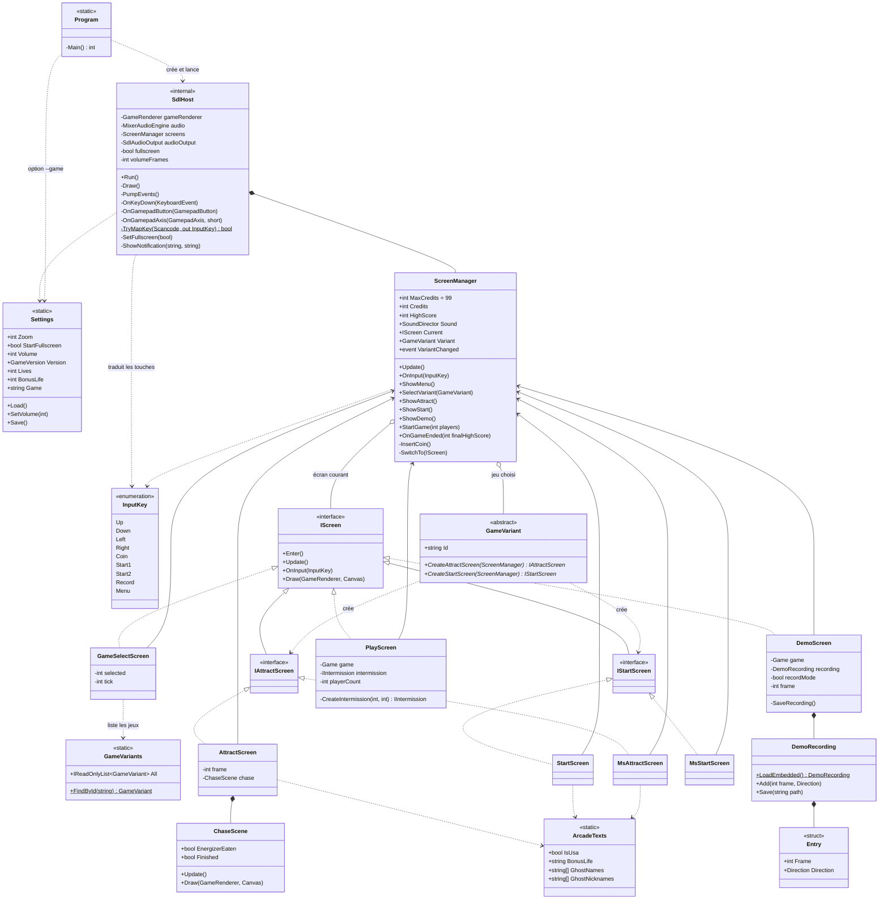

*Figure 2 : diagramme de classes : écrans et navigation*  
Ouvrir en grand : [SVG](diagrams/fr/02_classes_ecrans.svg) · [PNG](diagrams/fr/02_classes_ecrans.png)

### 2.2 Intermissions

PlayScreen affiche une seule IIntermission à la fois et met le Game en pause pendant ce temps. Le Game ne connaît que le numéro de l'acte à jouer (1, 2 ou 3) ; c'est le GameVariant du jeu choisi qui crée la scène correspondante. Pac-Man a trois classes de scène, une par acte, dessinées par code. Ms Pac-Man a une seule classe, MsIntermissionScene, qui rejoue les trois actes d'après des pistes de positions de sprites mesurées image par image sur l'arcade (MsIntermissionData).

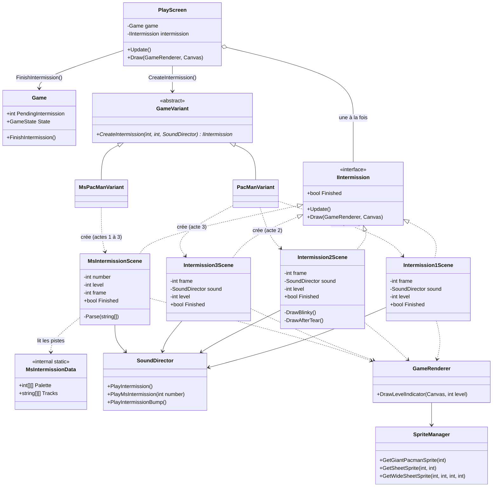

*Figure 3 : diagramme de classes : intermissions*  
Ouvrir en grand : [SVG](diagrams/fr/03_classes_intermissions.svg) · [PNG](diagrams/fr/03_classes_intermissions.png)

### 2.3 Moteur de jeu

Game est le centre du moteur. Il enchaîne les états de GameState, délègue les règles à ScoreKeeper, FruitManager, WaveScheduler et GhostHouse, et garde un PlayerState par joueur, chacun avec son propre labyrinthe. Les règles qui diffèrent d'un jeu à l'autre (labyrinthe du niveau, fantômes, fruit, durée des vagues, animation de mort) sont demandées au GameVariant ; FruitManager a ainsi deux versions, le fruit fixe de Pac-Man et le fruit mobile de Ms Pac-Man (MsFruitManager).

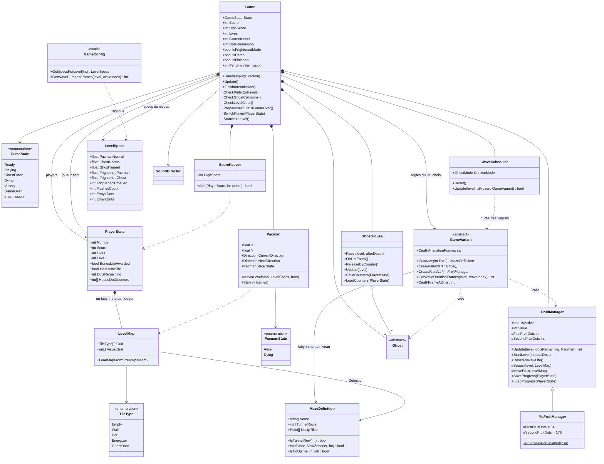

*Figure 4 : diagramme de classes : moteur de jeu*  
Ouvrir en grand : [SVG](diagrams/fr/04_classes_moteur.svg) · [PNG](diagrams/fr/04_classes_moteur.png)

### 2.4 Fantômes

Ghost contient tout ce qui est commun : déplacement pixel par pixel, choix de direction, vitesse, demi-tour. Chaque fantôme ne définit que sa cible de chasse. Inky garde une référence vers Blinky pour calculer la sienne, et Blinky ajoute l'état Cruise Elroy. Deux options, activées par le GameVariant de Ms Pac-Man, modifient le comportement commun : `WandersInScatter` fait errer le fantôme au hasard pendant le Scatter, et `ExitsTowardTarget` lui fait choisir sa direction à la sortie du nid d'après sa cible.

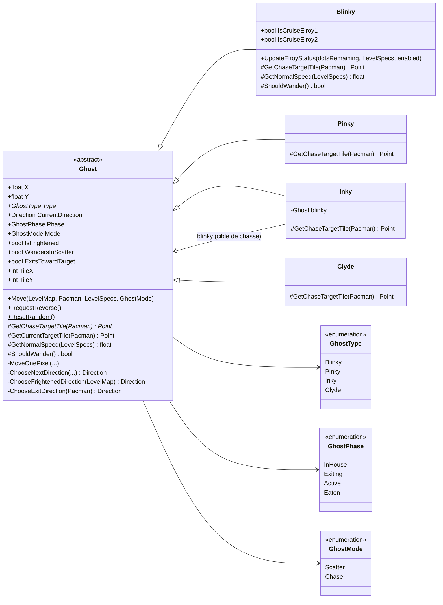

*Figure 5 : diagramme de classes : fantômes*  
Ouvrir en grand : [SVG](diagrams/fr/05_classes_fantomes.svg) · [PNG](diagrams/fr/05_classes_fantomes.png)

### 2.5 Rendu

GameRenderer dessine tout dans un Canvas natif de 224×288 (pixels 0xAARRGGBB), puis l'hôte l'envoie à SDL, qui l'agrandit à l'entier le plus proche. Un Sprite est une simple vue rectangulaire sur un Canvas, sans copie de pixels. PngDecoder décode la feuille `asset.png` du jeu choisi et SpriteManager la découpe en sprites mis en cache. Chaque jeu a sa feuille : Ms Pac-Man utilise MsPacManSprites, qui hérite de SpriteManager et remplace la découpe des personnages, des labyrinthes, des fruits et de l'animation de mort. Le GameRenderer change de jeu de sprites quand le ScreenManager signale un nouveau jeu (SetVariant) et peut aussi fournir celui d'un autre jeu (SpritesFor), ce que le menu de choix utilise pour dessiner le curseur.

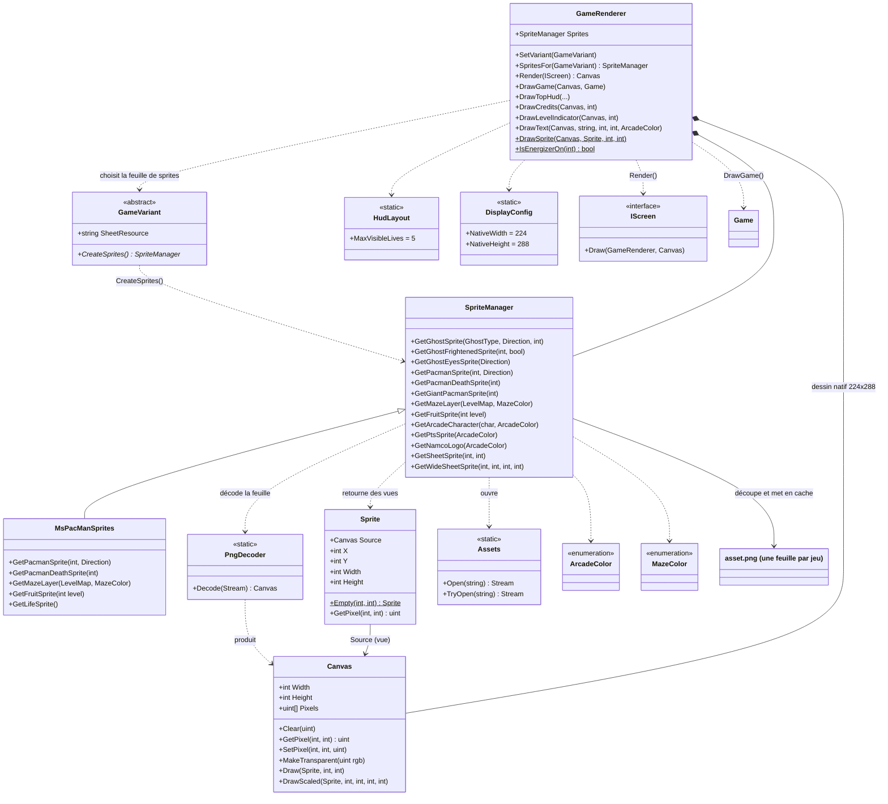

*Figure 6 : diagramme de classes : rendu*  
Ouvrir en grand : [SVG](diagrams/fr/06_classes_rendu.svg) · [PNG](diagrams/fr/06_classes_rendu.png)

### 2.6 Audio

SoundDirector traduit les événements du jeu en sons et garantit qu'un seul son de fond joue à la fois, via l'interface IAudioEngine. MixerAudioEngine décode les sons du jeu choisi (WavDecoder) quand le ScreenManager appelle LoadSoundPack, les mixe lui-même en flottants 48 kHz stéréo et applique le volume : 24 sons pour Pac-Man, auxquels s'ajoutent les sons propres à Ms Pac-Man (rebond du fruit, intermissions 2 et 3, choc de l'intermission 1). Il ne connaît aucune sortie audio : SdlAudioOutput, côté hôte, appelle Read() depuis le callback de SDL pour remplir le tampon de la carte son.

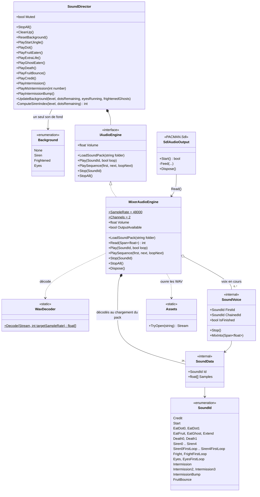

*Figure 7 : diagramme de classes : audio*  
Ouvrir en grand : [SVG](diagrams/fr/07_classes_audio.svg) · [PNG](diagrams/fr/07_classes_audio.png)

### 2.7 Les jeux (variantes)

GameVariant regroupe tout ce qui change d'un jeu à l'autre ; le moteur ne connaît que cette classe abstraite. GameVariants liste les jeux proposés par le menu (Pac-Man puis Ms Pac-Man). PacManVariant décrit le jeu d'origine : un seul labyrinthe, quatre fantômes classiques, un fruit fixe. MsPacManVariant décrit Ms Pac-Man : six labyrinthes choisis selon le niveau (MazeIndexForLevel), une seule phase Scatter de 7 s, des fantômes qui errent ou choisissent leur sortie selon leur cible, le fruit mobile MsFruitManager, une animation de mort propre, et ses propres écrans, sprites, sons et intermissions. Les paramètres communs (vitesses, seuils d'Elroy, mode effrayé) restent ceux de GameConfig.

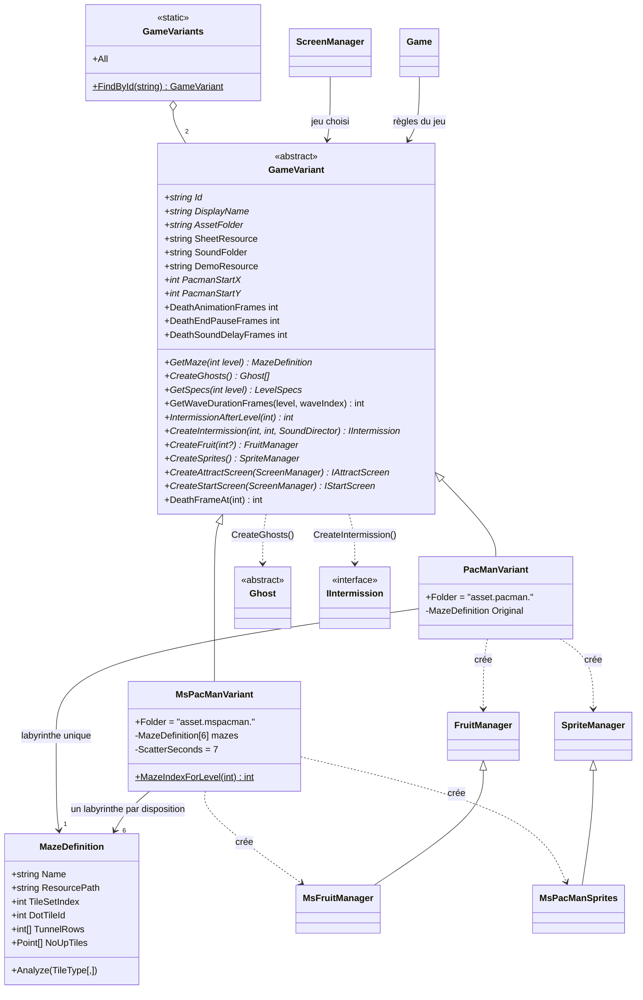

*Figure 8 : diagramme de classes : les jeux (variantes)*  
Ouvrir en grand : [SVG](diagrams/fr/08_classes_variantes.svg) · [PNG](diagrams/fr/08_classes_variantes.png)

## 3. Diagrammes de séquence

### 3.1 Une image de jeu à 60 Hz

La boucle de SdlHost.Run accumule le temps écoulé et appelle autant de fois que nécessaire la mise à jour logique, à pas fixe de 1/60 s (rattrapage limité à 100 ms), avant de redessiner. Le Canvas produit par GameRenderer est ensuite copié dans une texture SDL puis affiché. La vitesse du jeu reste ainsi identique quelle que soit la machine.

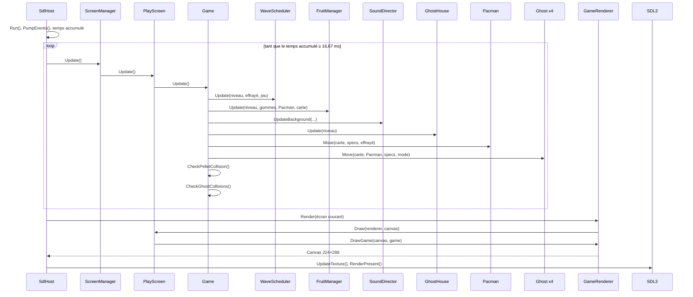

*Figure 9 : diagramme de séquence : une image de jeu à 60 Hz*  
Ouvrir en grand : [SVG](diagrams/fr/09_sequence_image.svg) · [PNG](diagrams/fr/09_sequence_image.png)

### 3.2 Du crédit au lancement d'une partie

Un crédit mène de l'attract mode à l'écran start ; la touche 1 démarre une partie et consomme un crédit. À la fin du GAME OVER, le ScreenManager revient à l'écran start s'il reste des crédits, sinon à l'attract mode. Les écrans concernés sont ceux du jeu choisi (voir 3.3 pour le choix du jeu) : le diagramme montre ceux de Pac-Man, ceux de Ms Pac-Man jouent le même rôle.

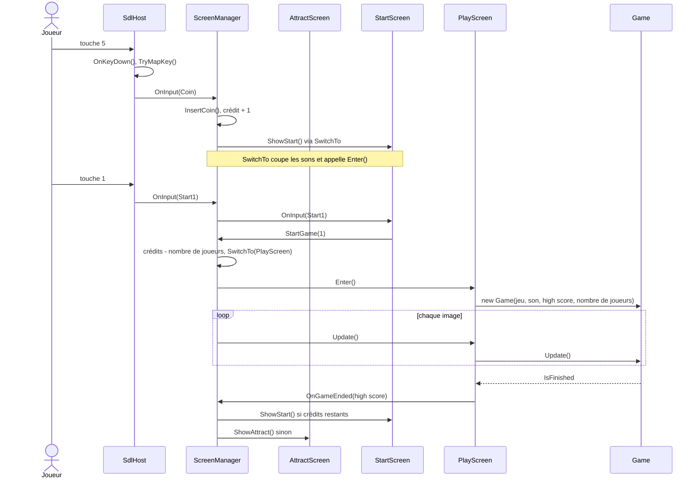

*Figure 10 : diagramme de séquence : du crédit au lancement d'une partie*  
Ouvrir en grand : [SVG](diagrams/fr/10_sequence_credit.svg) · [PNG](diagrams/fr/10_sequence_credit.png)

### 3.3 Du menu à l'attract mode

Au lancement, le ScreenManager affiche le menu de choix. Haut et Bas déplacent le curseur, 1 ou 2 valide. SelectVariant charge le pack de sons du jeu (seulement s'il change), prévient l'hôte, qui remplace la feuille de sprites du GameRenderer, puis démarre l'attract mode du jeu choisi. Échap depuis l'attract mode, la démo ou l'écran start ramène au menu ; les crédits et le high score repartent alors de zéro.

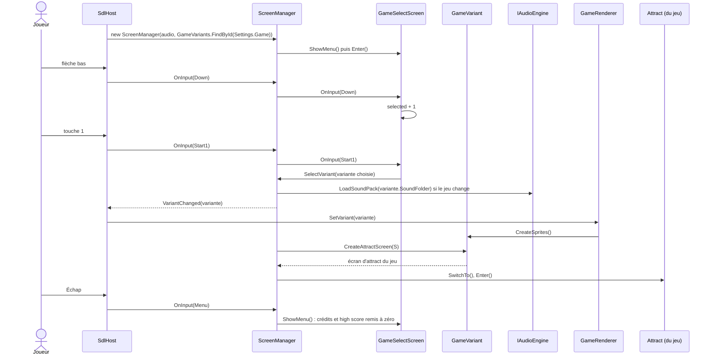

*Figure 11 : diagramme de séquence : du menu à l'attract mode*  
Ouvrir en grand : [SVG](diagrams/fr/11_sequence_choix_jeu.svg) · [PNG](diagrams/fr/11_sequence_choix_jeu.png)

## 4. Diagrammes d'états communs aux deux jeux

Chaque diagramme correspond à une énumération ou à une chronologie du code. Les durées sont en images à 60 Hz (60 images = 1 seconde). Ce chapitre regroupe les comportements partagés par Pac-Man et Ms Pac-Man ; les diagrammes propres à chaque jeu sont aux chapitres 5 et 6.

### 4.1 Cycle des écrans

Le ScreenManager enchaîne menu de choix du jeu, attract mode, démo, écran start et partie. Au lancement, le menu s'affiche, sauf si un jeu est imposé par `--game` ou `Game=` (on entre alors directement dans l'attract mode). Un crédit est accepté à tout moment : il fait quitter l'attract mode ou la démo pour l'écran start, et s'ajoute simplement au compteur ailleurs. Échap ramène au menu depuis l'attract mode, la démo ou l'écran start, jamais pendant une partie. L'enregistrement de la démo (F9) n'existe qu'en Debug.

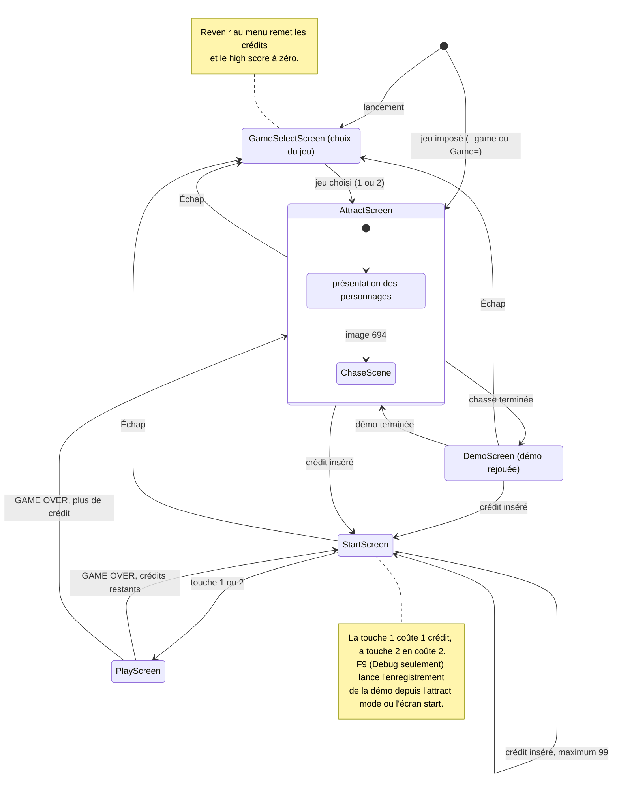

*Figure 12 : diagramme d'états : cycle des écrans*  
Ouvrir en grand : [SVG](diagrams/fr/12_etats_ecrans.svg) · [PNG](diagrams/fr/12_etats_ecrans.png)

### 4.2 États d'une partie

Game passe par sept états (GameState). Dying et Victory sont découpés en phases chronométrées. La durée de l'animation de mort et de la pause qui suit dépend du jeu (GameVariant). En démo, la mort se termine après l'animation et une seconde de pause, et une victoire termine la démo aussitôt.

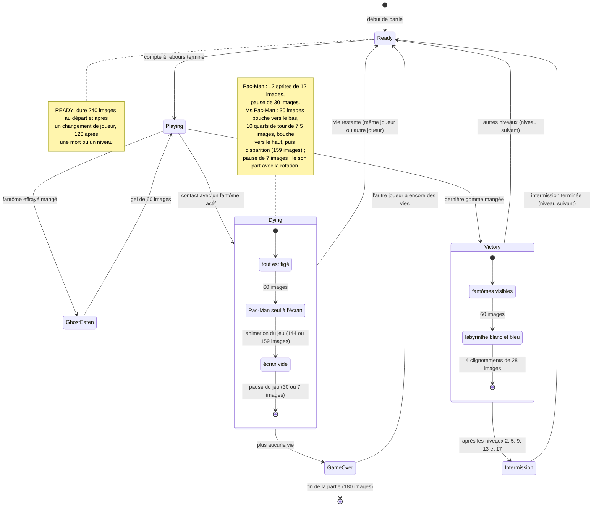

*Figure 13 : diagramme d'états : états d'une partie*  
Ouvrir en grand : [SVG](diagrams/fr/13_etats_partie.svg) · [PNG](diagrams/fr/13_etats_partie.png)

### 4.3 Cycle de vie d'un fantôme

Quatre phases (GhostPhase). Quand le fantôme est actif, deux dimensions évoluent indépendamment : le mode de vague (Scatter ou Chase) et l'état effrayé. À la sortie du nid, Pac-Man fait toujours partir le fantôme vers la gauche ; Ms Pac-Man lui fait choisir gauche ou droite d'après sa cible.

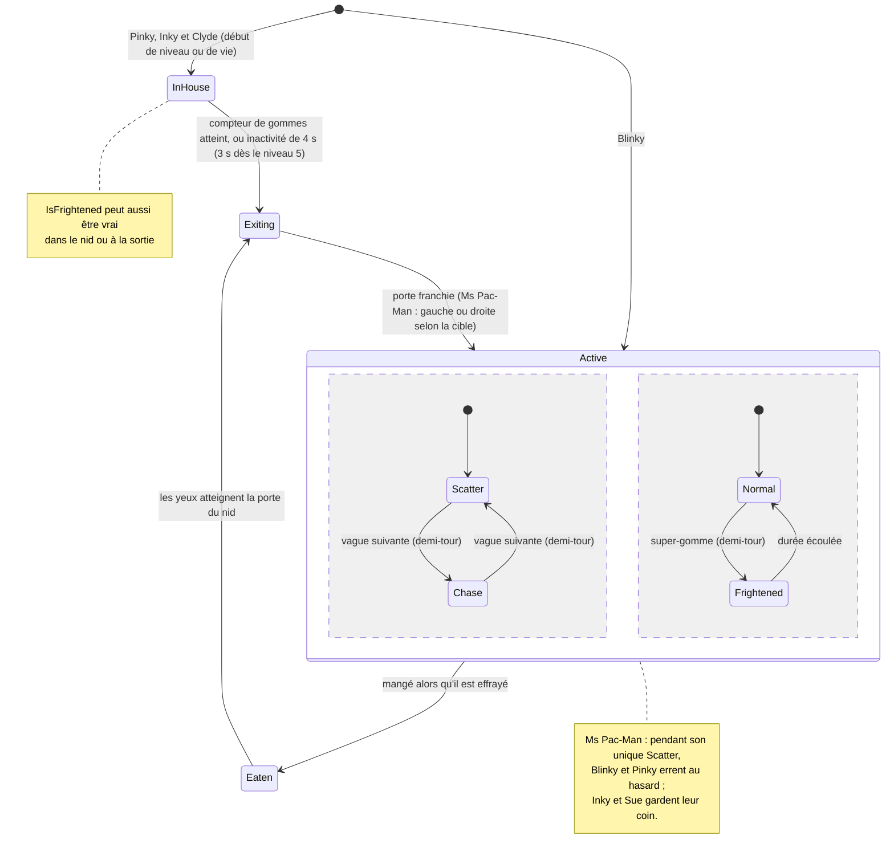

*Figure 14 : diagramme d'états : cycle de vie d'un fantôme*  
Ouvrir en grand : [SVG](diagrams/fr/14_etats_fantome.svg) · [PNG](diagrams/fr/14_etats_fantome.png)

### 4.4 Son de fond

Un seul son de fond joue à la fois, par priorité : yeux, puis panique, puis sirène. La sirène accélère par paliers quand il reste peu de gommes.

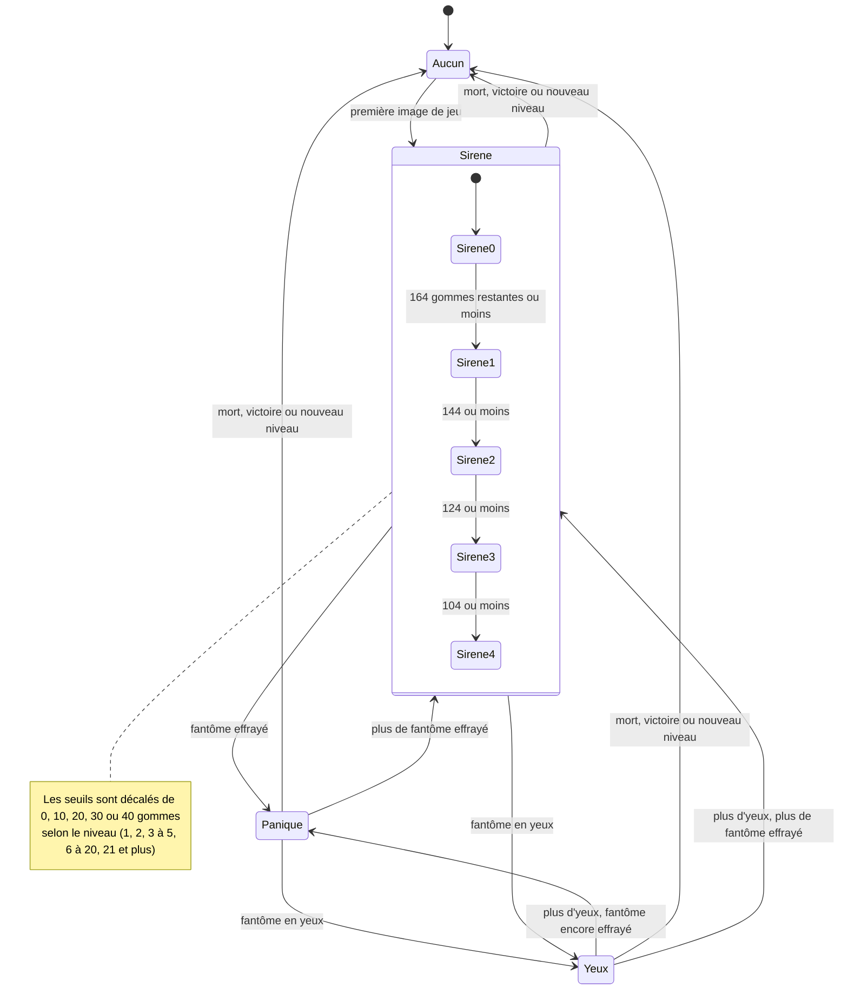

*Figure 15 : diagramme d'états : son de fond*  
Ouvrir en grand : [SVG](diagrams/fr/15_etats_son.svg) · [PNG](diagrams/fr/15_etats_son.png)

### 4.5 Mode 2 joueurs

L'alternance se fait à chaque vie perdue tant que l'autre joueur a encore des vies. Un joueur sans vie laisse la main à l'autre après son GAME OVER.

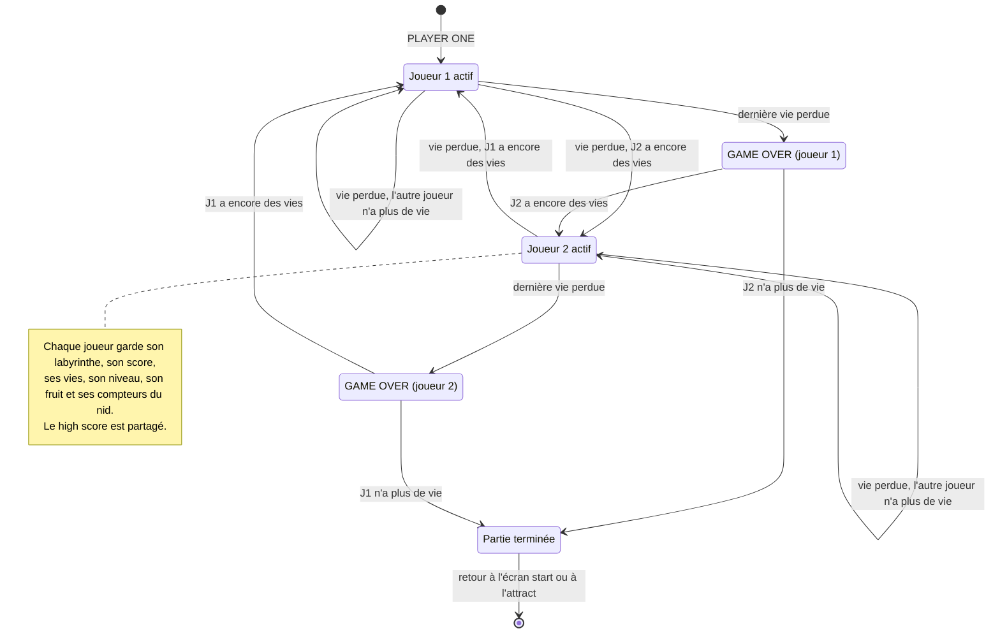

*Figure 16 : diagramme d'états : mode 2 joueurs*  
Ouvrir en grand : [SVG](diagrams/fr/16_etats_deux_joueurs.svg) · [PNG](diagrams/fr/16_etats_deux_joueurs.png)

## 5. Pac-Man (jeu d'origine)

Ce chapitre décrit ce qui est propre au Pac-Man de 1980, tel que le fournit `PacManVariant` : un seul labyrinthe, l'attract mode avec la présentation des fantômes, huit vagues Scatter / Chase, un fruit fixe, trois intermissions dessinées par code, et le comportement classique des quatre fantômes.

### 5.1 Attract mode de Pac-Man

AttractScreen suit la chronologie de l'arcade : le titre du tableau, puis les quatre fantômes l'un après l'autre (le sprite, puis son nom 60 images plus tard, puis son surnom 90 images après le sprite), la légende des points, le logo, et enfin la scène de chasse (ChaseScene). Quand le quatrième fantôme est mangé, la démo commence.

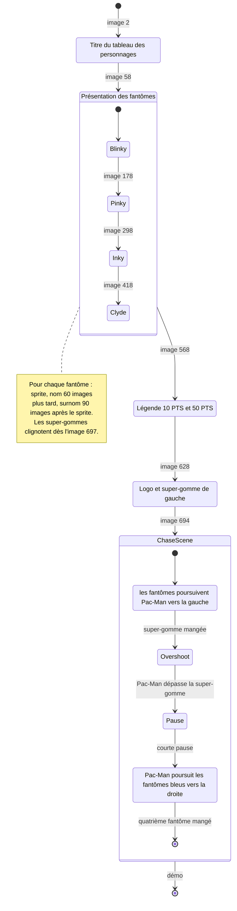

*Figure 17 : diagramme d'états : attract mode de Pac-Man*  
Ouvrir en grand : [SVG](diagrams/fr/17_etats_attract_pacman.svg) · [PNG](diagrams/fr/17_etats_attract_pacman.png)

### 5.2 Vagues Scatter / Chase de Pac-Man

Huit vagues alternent ; la dernière (Chase) dure jusqu'à la fin du niveau. Les durées dépendent du niveau (`GameConfig.GetWaveDurationFrames`) et sont détaillées en 5.7.3.

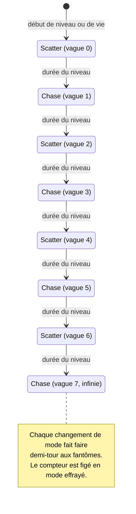

*Figure 18 : diagramme d'états : vagues Scatter et Chase de Pac-Man*  
Ouvrir en grand : [SVG](diagrams/fr/18_etats_vagues_pacman.svg) · [PNG](diagrams/fr/18_etats_vagues_pacman.png)

### 5.3 Fruit de Pac-Man

Le fruit de Pac-Man est immobile, sous le nid. Il apparaît quand 70 puis 170 gommes ont été mangées, reste entre 9 et 10 secondes (durée tirée au hasard) et disparaît s'il n'est pas mangé. Mangé, il laisse son score affiché 2 secondes. Une vie perdue fait disparaître le fruit visible, mais les seuils déjà passés ne sont pas rejoués.

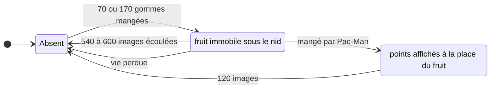

*Figure 19 : diagramme d'états : fruit de Pac-Man*  
Ouvrir en grand : [SVG](diagrams/fr/19_etats_fruit_pacman.svg) · [PNG](diagrams/fr/19_etats_fruit_pacman.png)

### 5.4 Intermission 1 de Pac-Man (après le niveau 2)

Pac-Man traverse l'écran vers la gauche, rattrapé peu à peu par Blinky ; puis un Blinky bleu repasse vers la droite, poursuivi par un Pac-Man géant. La musique de 5 s, jouée deux fois, démarre à l'image 20.

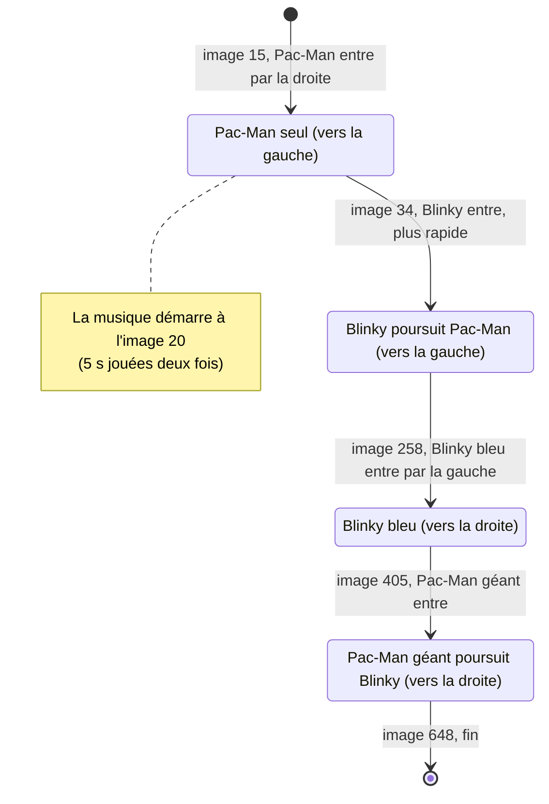

*Figure 20 : diagramme d'états : intermission 1*  
Ouvrir en grand : [SVG](diagrams/fr/20_etats_intermission1.svg) · [PNG](diagrams/fr/20_etats_intermission1.png)

### 5.5 Intermission 2 de Pac-Man (après le niveau 5)

La tunique de Blinky s'accroche à un clou et s'étire avec trois sprites successifs avant de se déchirer. La musique est coupée net à la fin de la scène, après l'écran noir.

```mermaid
stateDiagram-v2
  [*] --> PacmanSeul : image 16, Pac-Man entre par la droite
  PacmanSeul --> Poursuite : image 104, Blinky entre
  Poursuite --> Accroche : image 190, la tunique s'accroche au clou
  Accroche --> Dechire : image 326, la tunique se déchire
  Dechire --> RegardeBas : image 385, Blinky baisse les yeux
  RegardeBas --> Noir : image 503, écran noir
  Noir --> [*] : image 511, fin
  state "Pac-Man seul" as PacmanSeul
  state "Blinky poursuit Pac-Man" as Poursuite
  state "Tunique étirée (3 sprites selon les pas)" as Accroche
  state "Blinky troué, yeux en haut" as Dechire
  state "Blinky troué, yeux en bas" as RegardeBas
  state "Tout est noir" as Noir
```

*Figure 21 : diagramme d'états : intermission 2*  
Ouvrir en grand : [SVG](diagrams/fr/21_etats_intermission2.svg) · [PNG](diagrams/fr/21_etats_intermission2.png)

### 5.6 Intermission 3 de Pac-Man (après les niveaux 9, 13 et 17)

Pac-Man, poursuivi par Blinky à la tunique recousue, sort à gauche ; l'écran reste vide un instant, puis Blinky, déshabillé, rampe vers la droite en traînant sa tunique.

```mermaid
stateDiagram-v2
  [*] --> PacmanSeul : image 15, Pac-Man entre par la droite
  PacmanSeul --> Poursuite : image 56, Blinky entre, tunique recousue
  Poursuite --> EcranVide : image 235, tous deux sortis à gauche
  EcranVide --> Rampe : image 307, Blinky entre par la gauche
  Rampe --> [*] : image 533, fin
  state "Pac-Man seul" as PacmanSeul
  state "Blinky poursuit Pac-Man (vers la gauche)" as Poursuite
  state "Écran vide" as EcranVide
  state "Blinky rampe en traînant sa tunique (vers la droite)" as Rampe
```

*Figure 22 : diagramme d'états : intermission 3*  
Ouvrir en grand : [SVG](diagrams/fr/22_etats_intermission3.svg) · [PNG](diagrams/fr/22_etats_intermission3.png)

### 5.7 Analyse du comportement des fantômes

Les quatre fantômes suivent la même règle de déplacement ; seule la case qu'ils visent change, selon leur état et leur personnalité. Ms Pac-Man garde cette mécanique et la modifie sur quelques points, décrits au chapitre 6.

#### 5.7.1 Comment un fantôme choisit sa direction

À chaque centre de case, un fantôme choisit la sortie dont la case suivante est la plus proche de sa cible, en distance euclidienne au carré. Il n'y a ni recherche de chemin ni mémoire : la décision est locale, ce qui produit les trajectoires prévisibles de l'arcade.

- Les directions candidates sont testées dans l'ordre Haut, Gauche, Bas, Droite ; en cas d'égalité, la première gagne.
- Le demi-tour est interdit, sauf inversion imposée par un changement de mode.
- Les murs et la porte du nid sont exclus (la porte n'est franchie que par les yeux).
- Dans Pac-Man, aux quatre intersections (12,14), (15,14), (12,26) et (15,26), un fantôme actif ne peut pas tourner vers le haut ; Ms Pac-Man a ses propres intersections, selon le labyrinthe (6.1).

#### 5.7.2 Cible selon l'état

| État | Cible | Remarque |
| --- | --- | --- |
| Scatter | Coin propre au fantôme | Ils tournent en boucle autour d'un bloc |
| Chase | Case calculée par chaque fantôme (5.7.4) | Seule différence de personnalité |
| Effrayé | Aucune : choix pseudo-aléatoire | Ordre Haut, Droite, Bas, Gauche, graine fixe |
| Mangé (yeux) | Case (13,14), devant le nid | Vitesse 2 px par image |

#### 5.7.3 Alternance Scatter et Chase

Un planificateur de 8 vagues alterne Scatter (vagues paires) et Chase (vagues impaires), puis reste en Chase pour toujours à la 8e. Plus le niveau monte, plus la phase Scatter raccourcit, jusqu'à devenir une simple inversion de direction.

| Vague | Niveau 1 | Niveaux 2 à 4 | Niveaux 5 et plus |
| --- | --- | --- | --- |
| 1 Scatter | 7 s | 7 s | 5 s |
| 2 Chase | 20 s | 20 s | 20 s |
| 3 Scatter | 7 s | 7 s | 5 s |
| 4 Chase | 20 s | 20 s | 20 s |
| 5 Scatter | 5 s | 5 s | 5 s |
| 6 Chase | 20 s | 1033 s | 1037 s |
| 7 Scatter | 5 s | 1 image | 1 image |
| 8 Chase | infini | infini | infini |

Trois règles complètent ce tableau :

- Le chronomètre est gelé tant que les fantômes sont effrayés.
- À chaque changement de vague, tous les fantômes reçoivent une demande d'inversion de direction : c'est le seul signal visible d'un changement de mode.
- Un fantôme qui sort du nid prend le mode courant ; ceux qui y sont encore gardent la demande d'inversion et sortent donc par la droite au lieu de la gauche.

Une super-gomme demande aussi l'inversion, même quand la durée d'effroi du niveau est nulle (niveaux 17, 19, 20 et suivants).

#### 5.7.4 Ce qui distingue les quatre fantômes

Blinky vise Pac-Man, les autres visent un point calculé pour couper ou éviter sa route. C'est cette variété qui fait fonctionner la poursuite en tenaille.

| Fantôme | Cible en Chase | Coin Scatter | Rôle |
| --- | --- | --- | --- |
| Blinky (rouge) | La case de Pac-Man | Haut droite, (25,0) | Poursuivant direct, accélère (Elroy) |
| Pinky (rose) | 4 cases devant Pac-Man | Haut gauche, (2,0) | Embuscade |
| Inky (bleu) | Symétrique de Blinky par rapport à un point 2 cases devant Pac-Man | Bas droite, (27,34) | Imprévisible, dépend de Blinky |
| Clyde (orange) | Pac-Man s'il est à 8 cases ou plus, sinon son propre coin | Bas gauche, (0,34) | Poursuit de loin, fuit de près |

**Blinky** ne calcule rien : il vise la case occupée par Pac-Man et le suit à la trace. Il devient plus rapide quand il reste peu de gommes (Cruise Elroy, ci-dessous) et il ne retourne pas à son coin tant qu'il est en Elroy.

**Pinky** vise 4 cases devant Pac-Man dans sa direction. Quand Pac-Man monte, la cible est aussi décalée de 4 cases vers la gauche : c'est le dépassement de capacité de l'arcade, reproduit volontairement. Faire demi-tour face à Pinky le fait souvent repartir dans l'autre sens.

**Inky** est le plus complexe : on prend le point situé 2 cases devant Pac-Man (avec le même décalage de 2 cases à gauche quand il monte), on trace le vecteur de Blinky vers ce point, puis on le double. Inky se place donc de l'autre côté de Pac-Man par rapport à Blinky ; seul, il est inoffensif, mais combiné à Blinky il ferme les issues.

**Clyde** alterne : s'il est à 8 cases ou plus de Pac-Man (distance au carré de 64 ou plus), il le vise comme Blinky ; dès qu'il s'approche, il vise son coin du bas à gauche et s'éloigne. Il finit par tourner autour de ce coin sans jamais coincer le joueur.

#### 5.7.5 Cruise Elroy

Quand il reste peu de gommes, Blinky accélère en deux paliers et poursuit Pac-Man même pendant les phases Scatter. Le seuil dépend du niveau ; le second palier est à la moitié du premier.

| Niveaux | Gommes restantes (palier 1 / palier 2) | Vitesse palier 1 / palier 2 |
| --- | --- | --- |
| 1 | 20 / 10 | 0,80 / 0,85 |
| 2 | 30 / 15 | 0,90 / 0,95 |
| 3 à 4 | 40 / 20 | 0,90 / 0,95 |
| 5 | 40 / 20 | 1,00 / 1,05 |
| 6 à 8 | 50 / 25 | 1,00 / 1,05 |
| 9 à 11 | 60 / 30 | 1,00 / 1,05 |
| 12 à 14 | 80 / 40 | 1,00 / 1,05 |
| 15 à 18 | 100 / 50 | 1,00 / 1,05 |
| 19 et plus | 120 / 60 | 1,00 / 1,05 |

Après une mort de Pac-Man, l'Elroy est suspendu jusqu'à la sortie de Clyde du nid.

#### 5.7.6 Sortie du nid

Les fantômes ne sortent pas ensemble : chacun attend que Pac-Man ait mangé assez de gommes. Si Pac-Man cesse de manger, un minuteur force la sortie du premier fantôme en attente.

| Fantôme | Niveau 1 | Niveau 2 | Niveau 3 et plus |
| --- | --- | --- | --- |
| Blinky | Dehors dès le départ | Dehors | Dehors |
| Pinky | 0 gomme | 0 | 0 |
| Inky | 30 gommes | 0 | 0 |
| Clyde | 60 gommes | 50 | 0 |

Après une mort, un compteur global remplace ces seuils (Pinky à 7, Inky à 17, Clyde à 32 gommes). Le minuteur de sortie forcée vaut 4 s aux niveaux 1 à 4 et 3 s ensuite.

#### 5.7.7 Points à retenir

- Le danger vient de la combinaison : Blinky pousse, Pinky coupe, Inky ferme l'autre côté et Clyde relâche la pression de près.
- Le Scatter n'est pas une pause : il disperse les fantômes pour casser la tenaille, et ne dure presque plus aux niveaux élevés.
- Les inversions de direction, et non les couleurs ou les sons, annoncent un changement de mode.
- Les comportements « fautifs » (décalage de Pinky et d'Inky vers le haut, impasses de Haut aux quatre intersections) sont ceux de l'arcade d'origine et sont conservés.
- Ms Pac-Man rend les fantômes moins prévisibles : pendant son unique Scatter, Blinky et Pinky errent au hasard, et à la sortie du nid chacun choisit gauche ou droite d'après sa cible.

## 6. Ms Pac-Man (variante)

Ce chapitre décrit ce qui est propre à Ms Pac-Man, tel que le fournit `MsPacManVariant`. Le moteur, les vitesses, les seuils d'Elroy, la durée du mode effrayé et les compteurs de sortie du nid sont ceux de Pac-Man (chapitres 4 et 5) ; les labyrinthes, les vagues, les fantômes en Scatter et à la sortie du nid, le fruit, la mort, l'attract mode et les intermissions sont différents.

### 6.1 Ce qui change par rapport à Pac-Man

Ms Pac-Man réutilise les vitesses, les seuils d'Elroy, la durée du mode effrayé et les compteurs de sortie du nid de Pac-Man. Les différences portent sur les vagues, les cibles en Scatter, la sortie du nid, le fruit et les labyrinthes.

| Sujet | Pac-Man | Ms Pac-Man |
| --- | --- | --- |
| Vagues | 8 vagues, durées selon le niveau | Un seul Scatter de 7 s au début du niveau, puis Chase jusqu'à la fin |
| Cibles en Scatter | Le coin de chaque fantôme | Blinky et Pinky errent au hasard (sauf Blinky en Elroy) ; Inky et Sue gardent leur coin |
| Quatrième fantôme | Clyde | Sue, même comportement que Clyde |
| Décalage vers le haut de Pinky et d'Inky | Oui (bug de l'arcade) | Non |
| Sortie du nid | Toujours à gauche (à droite si une inversion est en attente) | Gauche ou droite selon la cible (à gauche s'il est effrayé) |
| Fruit | Fixe sous le nid, à 70 et 170 gommes, 9 à 10 s | Mobile, à 64 et 176 gommes, entre par un tunnel, fait le tour du nid et repart ; le second est ignoré si le premier est présent |
| Labyrinthes | 1 | 6, selon le niveau (1-2, 3-5, 6-9, 10-13, puis variantes de couleur par blocs de 4 niveaux) |
| Intersections sans montée | (12,14), (15,14), (12,26), (15,26) | Labyrinthes 1, 3 et 5 : (9,14), (18,14), (9,26), (18,26) ; labyrinthes 4 et 6 : (12,14), (15,14), (12,23), (15,23) ; labyrinthe 2 : aucune |
| Mort | Animation de 144 images, pause de 30 | Animation de 159 images (rotation de 900°), pause de 7 |

### 6.2 Labyrinthes selon le niveau

Ms Pac-Man a six labyrinthes (`MazeIndexForLevel`). Les quatre premiers se suivent aux niveaux 1-2, 3-5, 6-9 et 10-13 ; ensuite les labyrinthes 5 et 6, variantes de couleur des labyrinthes 3 et 4, alternent par blocs de 4 niveaux. Les tunnels de chaque labyrinthe sont repérés automatiquement au chargement de la carte (`MazeDefinition.Analyze`), ainsi que leurs zones lentes.

```mermaid
stateDiagram-v2
  [*] --> L1 : niveau 1
  state "Labyrinthe 1 (niveaux 1 et 2)" as L1
  state "Labyrinthe 2 (niveaux 3 à 5)" as L2
  state "Labyrinthe 3 (niveaux 6 à 9)" as L3
  state "Labyrinthe 4 (niveaux 10 à 13)" as L4
  state "Labyrinthe 5 (disposition du 3)" as L5
  state "Labyrinthe 6 (disposition du 4)" as L6
  L1 --> L2 : niveau 3
  L2 --> L3 : niveau 6
  L3 --> L4 : niveau 10
  L4 --> L5 : niveau 14
  L5 --> L6 : 4 niveaux plus tard
  L6 --> L5 : 4 niveaux plus tard
```

*Figure 23 : diagramme d'états : labyrinthes de Ms Pac-Man selon le niveau*  
Ouvrir en grand : [SVG](diagrams/fr/23_etats_labyrinthes_ms.svg) · [PNG](diagrams/fr/23_etats_labyrinthes_ms.png)

| Labyrinthe | Niveaux | Intersections où un fantôme actif ne peut pas tourner vers le haut |
| --- | --- | --- |
| 1 | 1 et 2 | (9,14), (18,14), (9,26), (18,26) |
| 2 | 3 à 5 | aucune |
| 3 | 6 à 9 | (9,14), (18,14), (9,26), (18,26) |
| 4 | 10 à 13 | (12,14), (15,14), (12,23), (15,23) |
| 5 | 14 à 17, 22 à 25, etc. | (9,14), (18,14), (9,26), (18,26) |
| 6 | 18 à 21, 26 à 29, etc. | (12,14), (15,14), (12,23), (15,23) |

### 6.3 Attract mode de Ms Pac-Man

MsAttractScreen affiche le titre dans un cadre lumineux (96 points qui défilent), puis présente Blinky, Pinky, Inky et Sue : le nom s'affiche, le fantôme entre par la droite sous le cadre, va jusqu'à gauche, marque 4 images d'arrêt au coin et monte s'empiler à gauche du cadre. Viennent ensuite « STARRING MS PAC-MAN » et l'entrée de Ms Pac-Man, puis la démo. La chronologie est mesurée sur l'arcade.

```mermaid
stateDiagram-v2
  [*] --> Titre : image 5
  state "Titre, cadre lumineux, logo Midway" as Titre
  state "WITH" as With
  state "Présentation des fantômes" as Fantomes {
    [*] --> Blinky : nom à l'image 62
    Blinky --> Pinky : nom à l'image 334
    Pinky --> Inky : nom à l'image 590
    Inky --> Sue : nom à l'image 830
    Blinky : entre à l'image 73
    Pinky : entre à l'image 345
    Inky : entre à l'image 601
    Sue : entre à l'image 841
  }
  state "STARRING MS PAC-MAN" as Starring
  state "Ms Pac-Man entre par la droite et s'arrête sous le cadre" as Entree
  Titre --> With : image 61
  With --> Fantomes : image 62
  Fantomes --> Starring : image 1054
  Starring --> Entree : image 1066
  Entree --> [*] : image 1304, démo
  note right of Fantomes
    Chaque fantôme entre par la droite sous le cadre,
    va à gauche, s'arrête 4 images au coin
    puis monte s'empiler. Son nom reste affiché
    jusqu'au nom suivant.
  end note
```

*Figure 24 : diagramme d'états : attract mode de Ms Pac-Man*  
Ouvrir en grand : [SVG](diagrams/fr/24_etats_attract_ms.svg) · [PNG](diagrams/fr/24_etats_attract_ms.png)

### 6.4 Vagues Scatter / Chase de Ms Pac-Man

Ms Pac-Man n'a qu'une phase Scatter, de 7 secondes, au début de chaque niveau et de chaque vie ; ensuite les fantômes restent en Chase jusqu'à la fin du niveau. `MsPacManVariant.GetWaveDurationFrames` renvoie 420 images pour la vague 0 et une durée infinie pour la suivante ; le WaveScheduler est le même que pour Pac-Man.

```mermaid
stateDiagram-v2
  direction LR
  [*] --> S0 : début de niveau ou de vie
  state "Scatter (vague 0)" as S0
  state "Chase (vague 1, infinie)" as C1
  S0 --> C1 : 420 images (7 s), demi-tour des fantômes
  C1 --> [*] : fin du niveau ou vie perdue
  note right of S0
    Le compteur est figé en mode effrayé.
  end note
```

*Figure 25 : diagramme d'états : vagues Scatter et Chase de Ms Pac-Man*  
Ouvrir en grand : [SVG](diagrams/fr/25_etats_vagues_ms.svg) · [PNG](diagrams/fr/25_etats_vagues_ms.png)

### 6.5 Fantômes de Ms Pac-Man

Les fantômes gardent le cycle de vie commun (4.3). Deux réglages posés par `MsPacManVariant.CreateGhosts` changent leur comportement. Pendant l'unique Scatter, Blinky et Pinky choisissent leurs virages au hasard (`WandersInScatter`) au lieu de rejoindre leur coin, sauf Blinky en Cruise Elroy, qui poursuit Ms Pac-Man ; Inky et Sue visent leur coin. À la sortie du nid (`ExitsTowardTarget`), le fantôme part du côté le plus proche de sa cible, ou au hasard s'il est en train d'errer ; s'il est effrayé, il sort comme dans Pac-Man. Les yeux d'un fantôme mangé ressortent aussitôt arrivés à la porte, sans attendre de compteur.

```mermaid
stateDiagram-v2
  [*] --> InHouse : Pinky, Inky et Sue
  [*] --> Active : Blinky
  InHouse --> Exiting : compteur de gommes ou minuteur, comme Pac-Man
  Exiting --> Active : porte franchie, direction choisie
  note left of Exiting
    Direction à la sortie du nid
    - effrayé, à gauche comme Pac-Man
    - Scatter et fantôme errant, gauche ou droite au hasard
    - sinon, côté le plus proche de la cible, à gauche si égalité
  end note
  state Active {
    [*] --> Scatter
    state "Scatter (7 s)" as Scatter {
      Errance : Blinky et Pinky, virages au hasard
      Coin : Inky et Sue, coin du labyrinthe
      Elroy : Blinky en Cruise Elroy, poursuit Ms Pac-Man
    }
    Scatter --> Chase : 7 s écoulées (demi-tour)
    Chase : cibles de chasse de Pac-Man, sans le décalage vers le haut
  }
  Active --> Eaten : mangé alors qu'il est effrayé
  Eaten --> Exiting : les yeux atteignent la porte, ressort aussitôt
```

*Figure 26 : diagramme d'états : fantômes de Ms Pac-Man*  
Ouvrir en grand : [SVG](diagrams/fr/26_etats_fantome_ms.svg) · [PNG](diagrams/fr/26_etats_fantome_ms.png)

### 6.6 Parcours du fruit de Ms Pac-Man

Le fruit de Ms Pac-Man n'est pas immobile : il entre par un tunnel tiré au hasard, rejoint le rectangle de couloirs qui entoure le nid (déduit de la porte du nid, donc propre à chaque labyrinthe), en fait un tour complet dans le sens des aiguilles d'une montre sans jamais faire demi-tour, puis repart par un autre tunnel par le plus court chemin. Il avance de 0,5 pixel par image (une case toutes les 16 images) et rebondit au même rythme ; le parcours dure de l'ordre de 14 s. Il apparaît à 64 et à 176 gommes mangées ; le second fruit est ignoré si le premier est encore à l'écran. Il ne disparaît jamais sur un minuteur : seulement en quittant le labyrinthe ou quand Ms Pac-Man le mange.

```mermaid
stateDiagram-v2
  [*] --> Approche : 64 ou 176 gommes mangées, aucun fruit à l'écran
  state "Approche : entre par un tunnel, rejoint la boucle autour du nid" as Approche
  state "Tour : un tour complet, sens horaire, sans demi-tour" as Tour
  state "Sortie : plus court chemin vers un autre tunnel" as Sortie
  state "Mangé : score affiché 2 s" as Mange
  Approche --> Tour : atteint un couloir de la boucle
  Approche --> Sortie : pas de boucle complète dans ce labyrinthe
  Tour --> Sortie : tour terminé, retour à la case d'arrivée
  Sortie --> [*] : quitte l'écran par le tunnel
  Approche --> Mange : touché par Ms Pac-Man
  Tour --> Mange : touché par Ms Pac-Man
  Sortie --> Mange : touché par Ms Pac-Man
  Mange --> [*]
```

*Figure 27 : diagramme d'états : parcours du fruit de Ms Pac-Man*  
Ouvrir en grand : [SVG](diagrams/fr/27_etats_fruit_ms.svg) · [PNG](diagrams/fr/27_etats_fruit_ms.png)

### 6.7 Mort de Ms Pac-Man

Au contact d'un fantôme, tous les sons sont coupés et le jeu se fige une seconde, comme pour Pac-Man. Ms Pac-Man reste ensuite 30 images bouche vers le bas, puis tourne sur elle-même dans le sens des aiguilles d'une montre : 10 quarts de tour (900°), un toutes les 7,5 images, pendant lesquels le son de mort est joué. Elle s'arrête bouche vers le haut, y reste 62 images, puis disparaît ; la vie suivante commence 7 images plus tard. L'animation dure 159 images (`DeathAnimationFrames`), contre 144 pour Pac-Man.

```mermaid
stateDiagram-v2
  [*] --> Gel : contact avec un fantôme, sons coupés
  state "Gel, tout est figé" as Gel
  state "Bouche vers le bas" as Bas
  state "Rotation horaire, 10 quarts de tour" as Rotation
  state "Bouche vers le haut" as Haut
  state "Disparue" as Disparue
  Gel --> Bas : 60 images
  Bas --> Rotation : 30 images, le son de mort démarre
  Rotation --> Haut : 67 images (un quart de tour toutes les 7,5 images)
  Haut --> Disparue : 62 images
  Disparue --> [*] : 7 images
```

*Figure 28 : diagramme d'états : mort de Ms Pac-Man*  
Ouvrir en grand : [SVG](diagrams/fr/28_etats_mort_ms.svg) · [PNG](diagrams/fr/28_etats_mort_ms.png)

### 6.8 Intermission 1 de Ms Pac-Man : « They Meet » (après le niveau 2)

Les trois intermissions de Ms Pac-Man sont jouées par une seule classe, MsIntermissionScene : chaque personnage suit une piste de positions relevées image par image sur l'arcade (MsIntermissionData). Chaque acte commence par une claquette portant son numéro (bras ouvert, à demi fermé à l'image 47, fermé à l'image 53, rouvert à l'image 59, claquette affichée jusqu'à l'image 86) et par son titre ; la musique de l'acte démarre à l'image 1. Dans l'acte 1, Pac-Man et Ms Pac-Man traversent d'abord l'écran en sens opposés, chacun poursuivi par un fantôme ; ils reviennent ensuite l'un vers l'autre sur la même ligne, montent ensemble au dernier moment, et les deux fantômes se percutent. Un cœur apparaît au-dessus du couple. La scène dure 611 images.

```mermaid
stateDiagram-v2
  [*] --> Claquette : image 1, musique de l'acte 1
  state "Claquette 1 et titre THEY MEET (titre jusqu'à l'image 55)" as Claquette
  state "Croisement : Pac-Man en haut vers la droite, Ms Pac-Man en bas vers la gauche" as Croisement
  state "Inky poursuit Pac-Man (image 145), Pinky poursuit Ms Pac-Man (image 149)" as Poursuite
  state "Écran vide" as Vide
  state "Rencontre : Pac-Man entre par la droite, Ms Pac-Man par la gauche, même ligne" as Rencontre
  state "Inky (image 402) et Pinky (image 405) entrent derrière eux" as Fantomes
  state "Pac-Man et Ms Pac-Man montent côte à côte" as Montee
  state "Inky et Pinky se percutent et rebondissent (bruitage)" as Choc
  state "Les fantômes ont disparu, un cœur apparaît au-dessus du couple" as Coeur
  Claquette --> Croisement : image 101
  Croisement --> Poursuite : image 145
  Poursuite --> Vide : image 352, tous sortis
  Vide --> Rencontre : image 355
  Rencontre --> Fantomes : image 402
  Fantomes --> Montee : image 459
  Montee --> Choc : image 487
  Choc --> Coeur : image 514
  Coeur --> [*] : image 611, fin
```

*Figure 29 : diagramme d'états : intermission 1 de Ms Pac-Man (They Meet)*  
Ouvrir en grand : [SVG](diagrams/fr/29_etats_intermission1_ms.svg) · [PNG](diagrams/fr/29_etats_intermission1_ms.png)

### 6.9 Intermission 2 de Ms Pac-Man : « The Chase » (après le niveau 5)

Après la claquette, Pac-Man et Ms Pac-Man se poursuivent à travers l'écran : trois traversées à des hauteurs différentes, en changeant de sens et de poursuivant, puis un dernier aller-retour très rapide. La scène dure 1284 images, la plus longue des trois ; l'écran reste vide entre les traversées.

```mermaid
stateDiagram-v2
  [*] --> Claquette : image 1, musique de l'acte 2
  state "Claquette 2 et titre THE CHASE (titre jusqu'à l'image 56)" as Claquette
  state "Traversée 1, en haut, vers la droite : Pac-Man devant, Ms Pac-Man derrière" as T1
  state "Traversée 2, en bas, vers la gauche : Ms Pac-Man devant, Pac-Man derrière" as T2
  state "Traversée 3, au milieu, vers la droite : Pac-Man devant, Ms Pac-Man derrière" as T3
  state "Aller rapide vers la gauche, en haut : Ms Pac-Man devant, Pac-Man derrière" as T4
  state "Retour rapide vers la droite, en bas : Pac-Man devant, Ms Pac-Man derrière" as T5
  state "Écran vide jusqu'à la fin de la musique" as Fin
  Claquette --> T1 : image 255
  T1 --> T2 : image 511 (écran vide depuis l'image 366)
  T2 --> T3 : image 767 (écran vide depuis l'image 620)
  T3 --> T4 : image 1021 (écran vide depuis l'image 873)
  T4 --> T5 : image 1070 environ
  T5 --> Fin : image 1125
  Fin --> [*] : image 1284, fin
```

*Figure 30 : diagramme d'états : intermission 2 de Ms Pac-Man (The Chase)*  
Ouvrir en grand : [SVG](diagrams/fr/30_etats_intermission2_ms.svg) · [PNG](diagrams/fr/30_etats_intermission2_ms.png)

### 6.10 Intermission 3 de Ms Pac-Man : « Junior » (après les niveaux 9, 13 et 17)

Pac-Man et Ms Pac-Man attendent en bas à gauche. Une cigogne traverse l'écran de droite à gauche en portant un paquet, le lâche en vol ; le paquet tombe en diagonale, rebondit jusqu'au couple et s'ouvre sur un bébé Pac-Man. Le paquet reste visible de son entrée jusqu'à sa transformation. La scène dure 504 images.

```mermaid
stateDiagram-v2
  [*] --> Claquette : image 1, musique de l'acte 3
  state "Claquette 3 et titre JUNIOR (titre jusqu'à l'image 55)" as Claquette
  state "Pac-Man et Ms Pac-Man attendent en bas à gauche" as Attente
  state "La cigogne entre par la droite (image 102) avec le paquet (image 115)" as Cigogne
  state "Le paquet est lâché, tombe en diagonale et rebondit" as Chute
  state "Le paquet s'immobilise près du couple" as Pose
  state "Le paquet s'ouvre : bébé Pac-Man" as Bebe
  state "Écran vide" as Vide
  Claquette --> Attente : image 91
  Attente --> Cigogne : image 102
  Cigogne --> Chute : image 221
  Chute --> Pose : image 378
  Pose --> Bebe : image 384
  Bebe --> Vide : image 446 (la cigogne est sortie à l'image 396)
  Vide --> [*] : image 504, fin
```

*Figure 31 : diagramme d'états : intermission 3 de Ms Pac-Man (Junior)*  
Ouvrir en grand : [SVG](diagrams/fr/31_etats_intermission3_ms.svg) · [PNG](diagrams/fr/31_etats_intermission3_ms.png)
