# Pac-Man (C# WinForms) : UML et diagrammes d'états

Ce document décrit l'architecture finale du jeu en 18 diagrammes : un diagramme de paquets, 6 diagrammes de classes, 2 diagrammes de séquence et 9 diagrammes d'états, tous établis à partir du code source. Les diagrammes sont écrits en [Mermaid](https://mermaid.js.org) et s'affichent directement dans les visionneuses Markdown qui le prennent en charge (GitHub, GitLab, VS Code avec extension, Obsidian…).

## 1. Vue d'ensemble

Les sept dossiers du projet forment trois niveaux : l'interface (UI) et les écrans (Screens) pilotent le jeu (Game, Ghosts, Maze), qui s'appuie sur le rendu (Graphics) et l'audio (Audio). Game et Ghosts sont étroitement liés : Game crée les quatre fantômes, et un fantôme lit Pacman et LevelSpecs, définis dans Game.

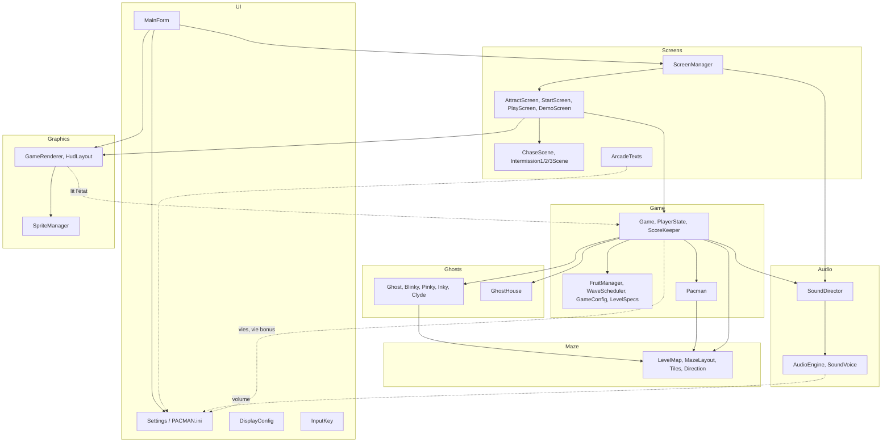

*Figure 1 : diagramme de paquets : les sept dossiers et leurs dépendances*

| Dossier | Rôle | Classes principales |
| --- | --- | --- |
| UI | Fenêtre, clavier, plein écran, réglages `PACMAN.ini` | MainForm, Settings, DisplayConfig, InputKey |
| Screens | Enchaînement des écrans, crédits, intermissions | ScreenManager, IScreen, AttractScreen, StartScreen, PlayScreen, DemoScreen, Intermission1/2/3Scene |
| Game | Règles et état d'une partie | Game, PlayerState, ScoreKeeper, FruitManager, WaveScheduler, Pacman, GameConfig |
| Ghosts | Comportement des fantômes et du nid | Ghost, Blinky, Pinky, Inky, Clyde, GhostHouse |
| Maze | Labyrinthe, cases, directions | LevelMap, MazeLayout, Tiles, Direction |
| Graphics | Dessin à la résolution de l'arcade (224×288) | GameRenderer, SpriteManager, HudLayout |
| Audio | Sons, mixage et volume | SoundDirector, AudioEngine, SoundVoice |

## 2. Diagrammes de classes

Les membres affichés sont les plus significatifs, pas la liste complète. Les relations suivent l'UML : flèche creuse pour l'héritage ou l'implémentation d'une interface, losange plein pour la composition, losange creux pour l'agrégation, trait pointillé pour une dépendance.

### 2.1 Écrans et navigation

MainForm possède un ScreenManager, qui garde l'écran courant derrière l'interface IScreen. Les crédits, le high score et le son traversent les écrans : ils vivent dans le ScreenManager.

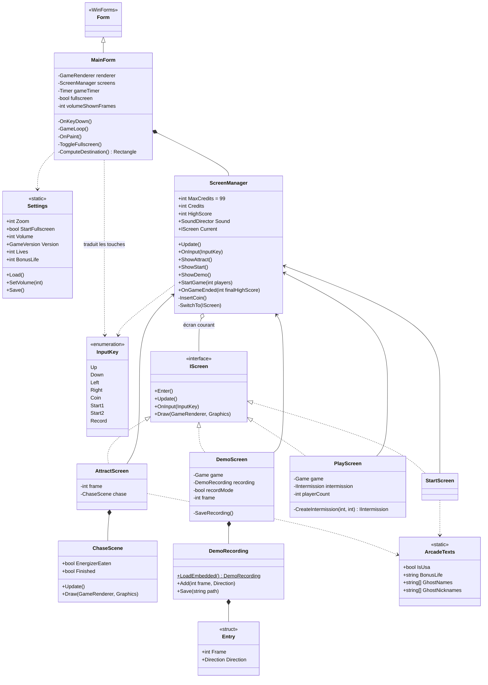

*Figure 2 : diagramme de classes : écrans et navigation*

### 2.2 Intermissions

PlayScreen affiche une seule IIntermission à la fois et met le Game en pause pendant ce temps. Le Game ne connaît que le numéro de l'acte à jouer (1, 2 ou 3) ; c'est PlayScreen qui crée la scène correspondante.

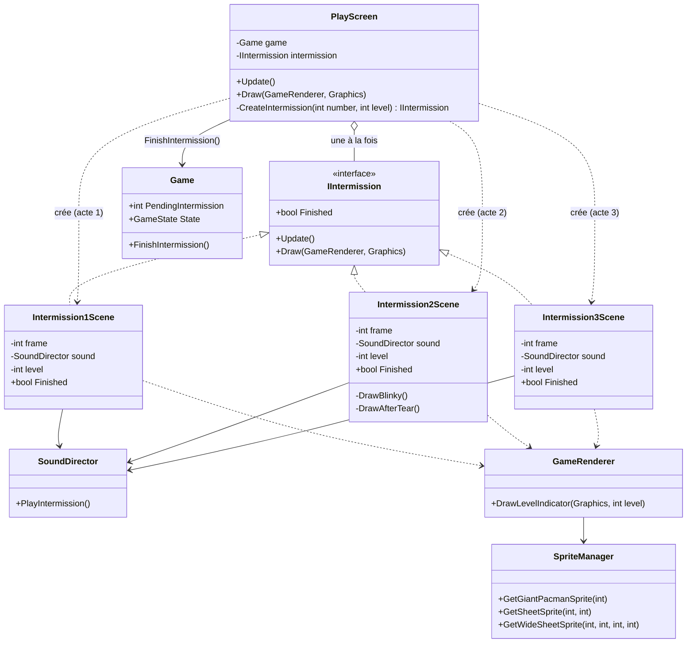

*Figure 3 : diagramme de classes : intermissions*

### 2.3 Moteur de jeu

Game est le centre du moteur. Il enchaîne les états de GameState, délègue les règles à ScoreKeeper, FruitManager, WaveScheduler et GhostHouse, et garde un PlayerState par joueur, chacun avec son propre labyrinthe.

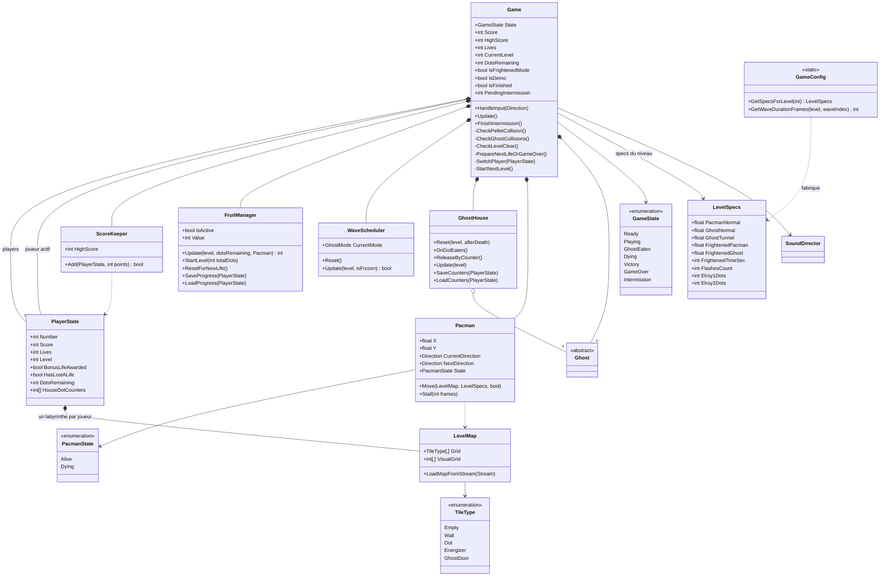

*Figure 4 : diagramme de classes : moteur de jeu*

### 2.4 Fantômes

Ghost contient tout ce qui est commun : déplacement pixel par pixel, choix de direction, vitesse, demi-tour. Chaque fantôme ne définit que sa cible de chasse. Inky garde une référence vers Blinky pour calculer la sienne, et Blinky ajoute l'état Cruise Elroy.

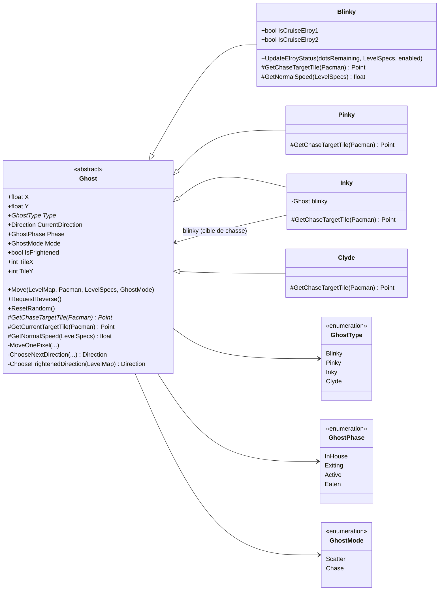

*Figure 5 : diagramme de classes : fantômes*

### 2.5 Rendu

GameRenderer dessine tout dans un bitmap natif de 224×288, puis l'agrandit d'un bloc dans le rectangle calculé par MainForm. SpriteManager découpe la feuille unique `asset.png` et garde chaque sprite en cache.

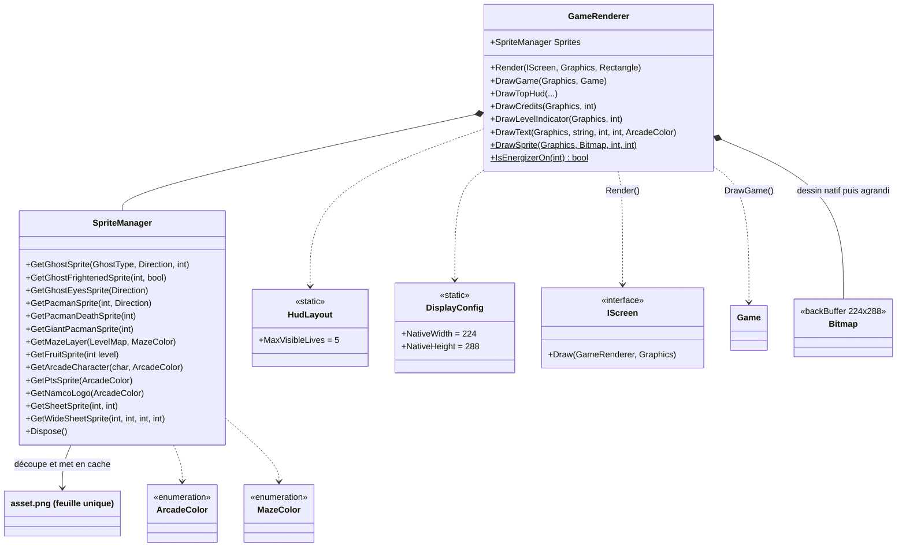

*Figure 6 : diagramme de classes : rendu*

### 2.6 Audio

SoundDirector traduit les événements du jeu en sons et garantit qu'un seul son de fond joue à la fois. AudioEngine décode les 24 sons au démarrage, les mixe avec NAudio, puis applique le volume avant la sortie WaveOut.

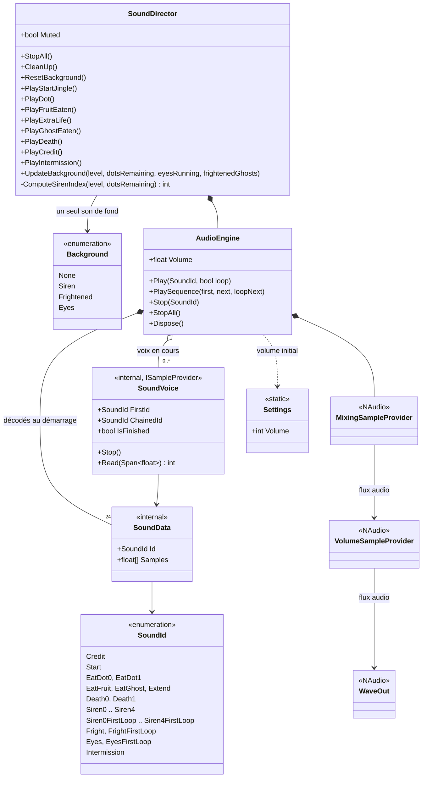

*Figure 7 : diagramme de classes : audio*

## 3. Diagrammes de séquence

### 3.1 Une image de jeu à 60 Hz

Le Timer de MainForm accumule le temps écoulé et appelle autant de fois que nécessaire la mise à jour logique, à pas fixe de 1/60 s, avant de redessiner. La vitesse du jeu reste ainsi identique quelle que soit la machine.

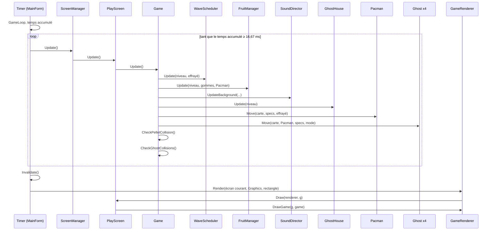

*Figure 17 : diagramme de séquence : une image de jeu à 60 Hz*

### 3.2 Du crédit au lancement d'une partie

Un crédit mène de l'attract mode à l'écran start ; la touche 1 démarre une partie et consomme un crédit. À la fin du GAME OVER, le ScreenManager revient à l'écran start s'il reste des crédits, sinon à l'attract mode.

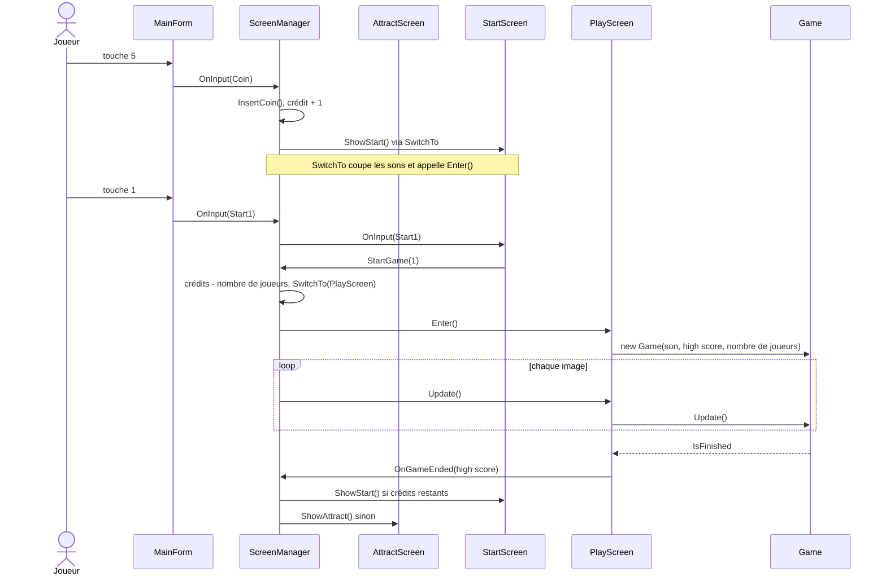

*Figure 18 : diagramme de séquence : du crédit au lancement d'une partie*

## 4. Diagrammes d'états

Chaque diagramme correspond à une énumération ou à une chronologie du code. Les durées sont en images à 60 Hz (60 images = 1 seconde).

### 4.1 Cycle des écrans

Le ScreenManager enchaîne attract mode, démo, écran start et partie. Un crédit est accepté à tout moment : il fait quitter l'attract mode ou la démo pour l'écran start, et s'ajoute simplement au compteur ailleurs. L'enregistrement de la démo (F9) n'existe qu'en Debug.

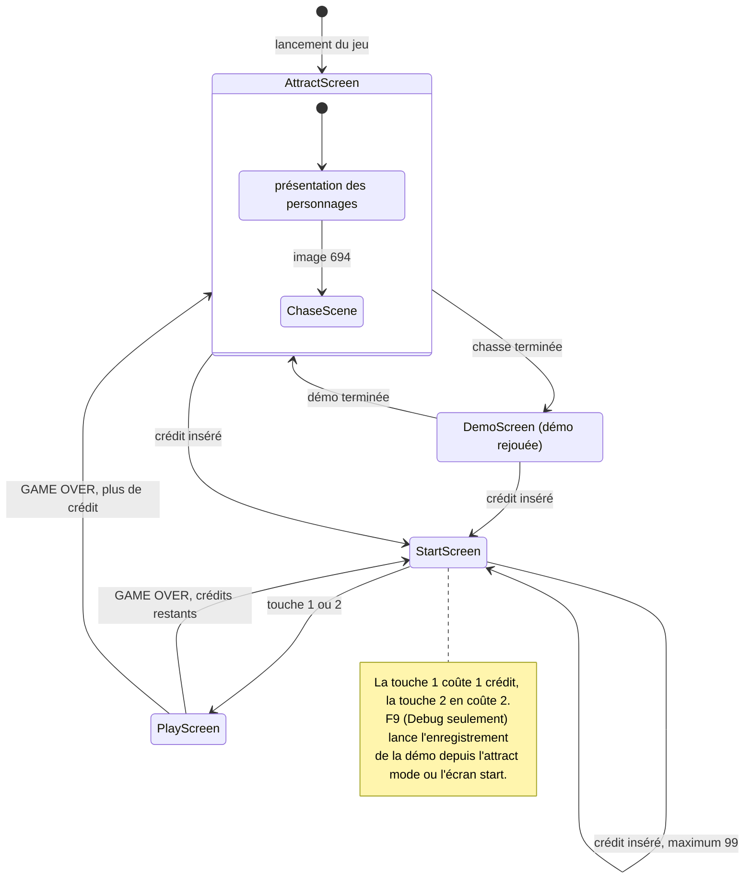

*Figure 8 : diagramme d'états : cycle des écrans*

### 4.2 États d'une partie

Game passe par sept états (GameState). Dying et Victory sont découpés en phases chronométrées. En démo, la mort se termine après l'animation et une seconde de pause, et une victoire termine la démo aussitôt.

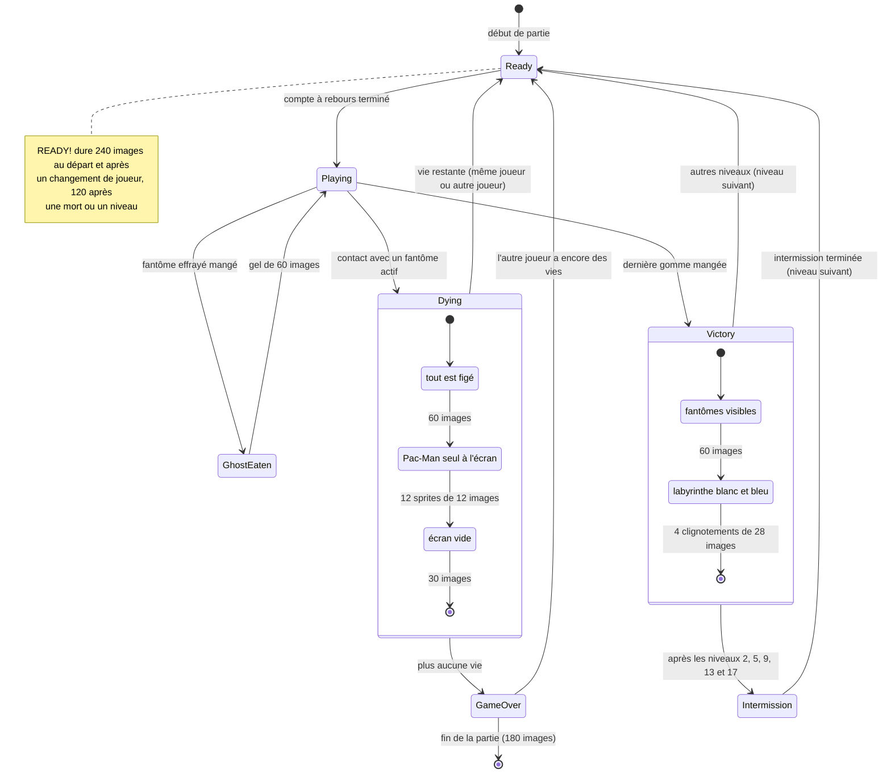

*Figure 9 : diagramme d'états : états d'une partie*

### 4.3 Cycle de vie d'un fantôme

Quatre phases (GhostPhase). Quand le fantôme est actif, deux dimensions évoluent indépendamment : le mode de vague (Scatter ou Chase) et l'état effrayé.

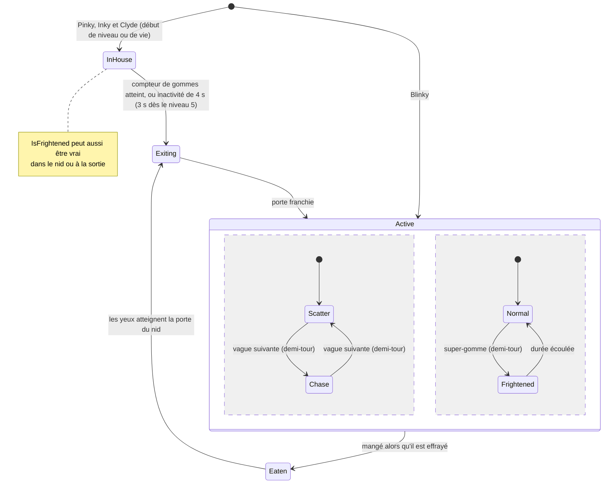

*Figure 10 : diagramme d'états : cycle de vie d'un fantôme*

### 4.4 Vagues Scatter / Chase

Huit vagues alternent ; la dernière (Chase) dure jusqu'à la fin du niveau. Les durées dépendent du niveau (`GameConfig.GetWaveDurationFrames`).

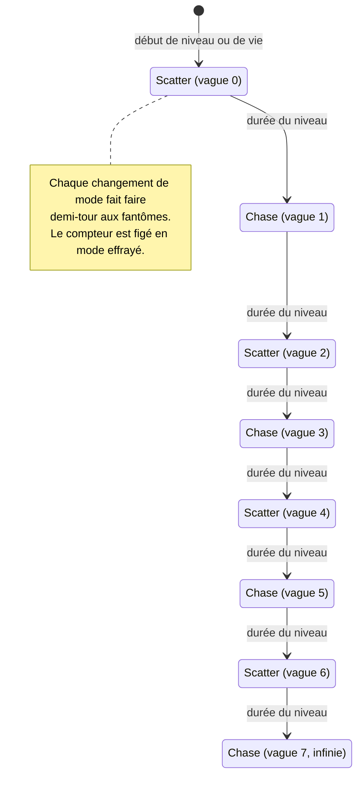

*Figure 11 : diagramme d'états : vagues Scatter et Chase*

### 4.5 Son de fond

Un seul son de fond joue à la fois, par priorité : yeux, puis panique, puis sirène. La sirène accélère par paliers quand il reste peu de gommes.

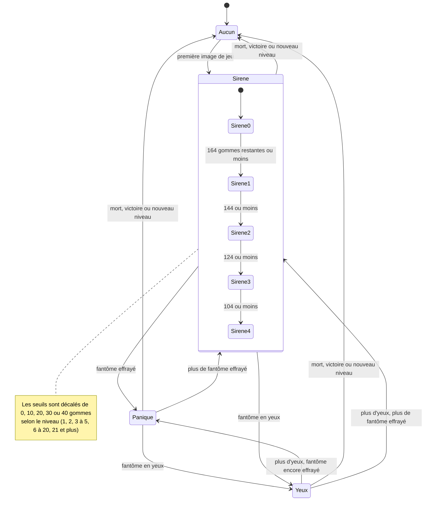

*Figure 12 : diagramme d'états : son de fond*

### 4.6 Mode 2 joueurs

L'alternance se fait à chaque vie perdue tant que l'autre joueur a encore des vies. Un joueur sans vie laisse la main à l'autre après son GAME OVER.

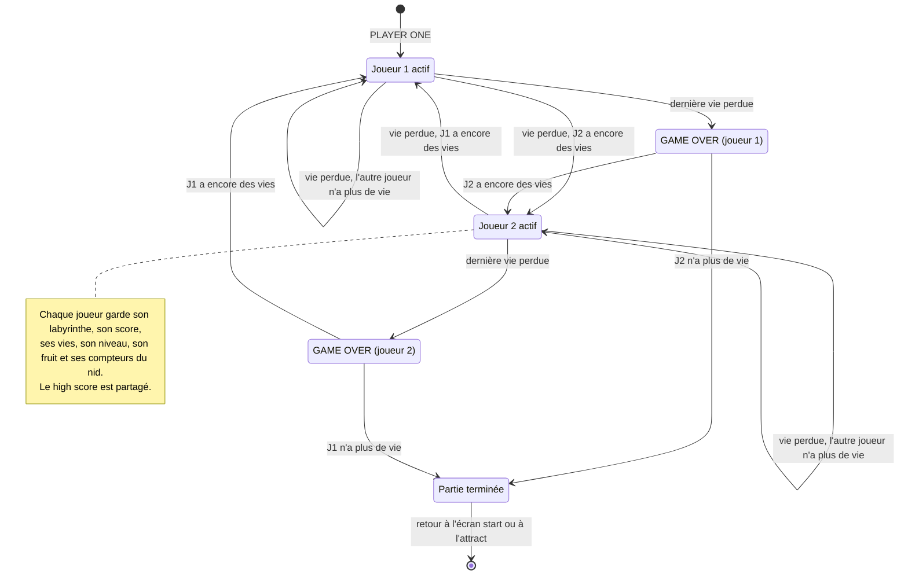

*Figure 13 : diagramme d'états : mode 2 joueurs*

### 4.7 Intermission 1 (après le niveau 2)

Pac-Man traverse l'écran vers la gauche, rattrapé peu à peu par Blinky ; puis un Blinky bleu repasse vers la droite, poursuivi par un Pac-Man géant. La musique de 5 s, jouée deux fois, démarre à l'image 20.

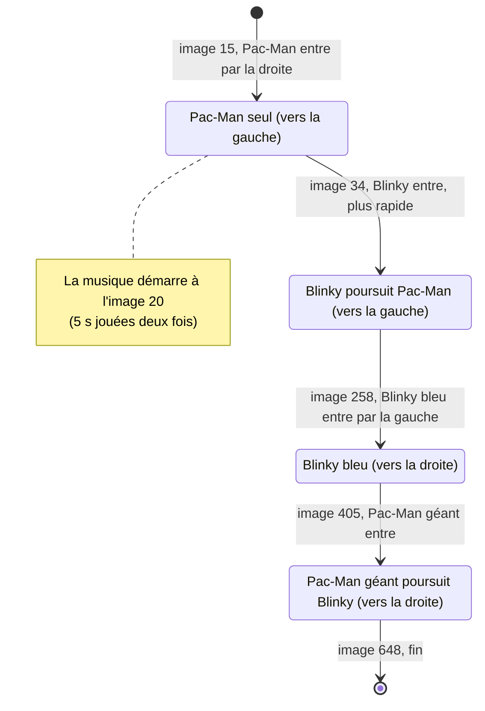

*Figure 14 : diagramme d'états : intermission 1*

### 4.8 Intermission 2 (après le niveau 5)

La tunique de Blinky s'accroche à un clou et s'étire avec trois sprites successifs avant de se déchirer. La musique est coupée net à la fin de la scène, après l'écran noir.

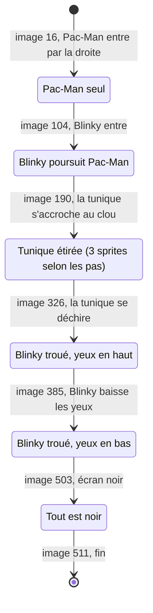

*Figure 15 : diagramme d'états : intermission 2*

### 4.9 Intermission 3 (après les niveaux 9, 13 et 17)

Pac-Man, poursuivi par Blinky à la tunique recousue, sort à gauche ; l'écran reste vide un instant, puis Blinky, déshabillé, rampe vers la droite en traînant sa tunique.

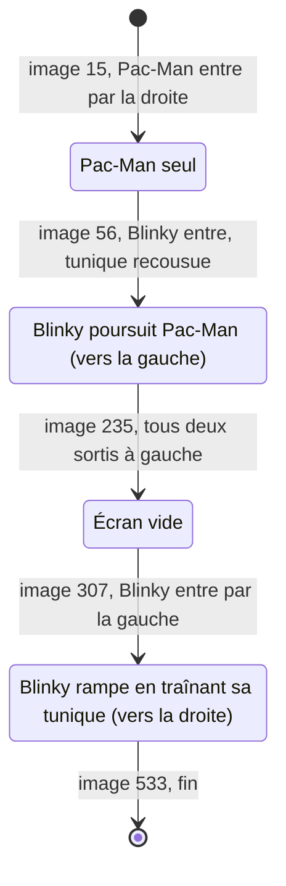

*Figure 16 : diagramme d'états : intermission 3*

## 5. Analyse du comportement des fantômes

Les quatre fantômes suivent la même règle de déplacement ; seule la case qu'ils visent change, selon leur état et leur personnalité.

### 5.1 Comment un fantôme choisit sa direction

À chaque centre de case, un fantôme choisit la sortie dont la case suivante est la plus proche de sa cible, en distance euclidienne au carré. Il n'y a ni recherche de chemin ni mémoire : la décision est locale, ce qui produit les trajectoires prévisibles de l'arcade.

- Les directions candidates sont testées dans l'ordre Haut, Gauche, Bas, Droite ; en cas d'égalité, la première gagne.
- Le demi-tour est interdit, sauf inversion imposée par un changement de mode.
- Les murs et la porte du nid sont exclus (la porte n'est franchie que par les yeux).
- Aux quatre intersections (12,14), (15,14), (12,26) et (15,26), un fantôme actif ne peut pas tourner vers le haut.

### 5.2 Cible selon l'état

| État | Cible | Remarque |
| --- | --- | --- |
| Scatter | Coin propre au fantôme | Ils tournent en boucle autour d'un bloc |
| Chase | Case calculée par chaque fantôme (5.4) | Seule différence de personnalité |
| Effrayé | Aucune : choix pseudo-aléatoire | Ordre Haut, Droite, Bas, Gauche, graine fixe |
| Mangé (yeux) | Case (13,14), devant le nid | Vitesse 2 px par image |

### 5.3 Alternance Scatter et Chase

Un planificateur de 8 vagues alterne Scatter (vagues paires) et Chase (vagues impaires), puis reste en Chase pour toujours à la 8e. Plus le niveau monte, plus la phase Scatter raccourcit, jusqu'à devenir une simple inversion de direction.

| Vague | Niveau 1 | Niveaux 2 à 4 | Niveaux 5 et plus |
| --- | --- | --- | --- |
| 1 Scatter | 7 s | 7 s | 5 s |
| 2 Chase | 20 s | 20 s | 20 s |
| 3 Scatter | 7 s | 7 s | 5 s |
| 4 Chase | 20 s | 20 s | 20 s |
| 5 Scatter | 5 s | 5 s | 5 s |
| 6 Chase | 20 s | 1033 s | 1037 s |
| 7 Scatter | 5 s | 1 image | 1 image |
| 8 Chase | infini | infini | infini |

Trois règles complètent ce tableau :

- Le chronomètre est gelé tant que les fantômes sont effrayés.
- À chaque changement de vague, tous les fantômes reçoivent une demande d'inversion de direction : c'est le seul signal visible d'un changement de mode.
- Un fantôme qui sort du nid prend le mode courant ; ceux qui y sont encore gardent la demande d'inversion et sortent donc par la droite au lieu de la gauche.

Une super-gomme demande aussi l'inversion, même quand la durée d'effroi du niveau est nulle (niveaux 17, 19, 20 et suivants).

### 5.4 Ce qui distingue les quatre fantômes

Blinky vise Pac-Man, les autres visent un point calculé pour couper ou éviter sa route. C'est cette variété qui fait fonctionner la poursuite en tenaille.

| Fantôme | Cible en Chase | Coin Scatter | Rôle |
| --- | --- | --- | --- |
| Blinky (rouge) | La case de Pac-Man | Haut droite, (25,0) | Poursuivant direct, accélère (Elroy) |
| Pinky (rose) | 4 cases devant Pac-Man | Haut gauche, (2,0) | Embuscade |
| Inky (bleu) | Symétrique de Blinky par rapport à un point 2 cases devant Pac-Man | Bas droite, (27,34) | Imprévisible, dépend de Blinky |
| Clyde (orange) | Pac-Man s'il est à 8 cases ou plus, sinon son propre coin | Bas gauche, (0,34) | Poursuit de loin, fuit de près |

**Blinky** ne calcule rien : il vise la case occupée par Pac-Man et le suit à la trace. Il devient plus rapide quand il reste peu de gommes (Cruise Elroy, ci-dessous) et il ne retourne pas à son coin tant qu'il est en Elroy.

**Pinky** vise 4 cases devant Pac-Man dans sa direction. Quand Pac-Man monte, la cible est aussi décalée de 4 cases vers la gauche : c'est le dépassement de capacité de l'arcade, reproduit volontairement. Faire demi-tour face à Pinky le fait souvent repartir dans l'autre sens.

**Inky** est le plus complexe : on prend le point situé 2 cases devant Pac-Man (avec le même décalage de 2 cases à gauche quand il monte), on trace le vecteur de Blinky vers ce point, puis on le double. Inky se place donc de l'autre côté de Pac-Man par rapport à Blinky ; seul, il est inoffensif, mais combiné à Blinky il ferme les issues.

**Clyde** alterne : s'il est à 8 cases ou plus de Pac-Man (distance au carré de 64 ou plus), il le vise comme Blinky ; dès qu'il s'approche, il vise son coin du bas à gauche et s'éloigne. Il finit par tourner autour de ce coin sans jamais coincer le joueur.

### 5.5 Cruise Elroy

Quand il reste peu de gommes, Blinky accélère en deux paliers et poursuit Pac-Man même pendant les phases Scatter. Le seuil dépend du niveau ; le second palier est à la moitié du premier.

| Niveaux | Gommes restantes (palier 1 / palier 2) | Vitesse palier 1 / palier 2 |
| --- | --- | --- |
| 1 | 20 / 10 | 0,80 / 0,85 |
| 2 | 30 / 15 | 0,90 / 0,95 |
| 3 à 4 | 40 / 20 | 0,90 / 0,95 |
| 5 | 40 / 20 | 1,00 / 1,05 |
| 6 à 8 | 50 / 25 | 1,00 / 1,05 |
| 9 à 11 | 60 / 30 | 1,00 / 1,05 |
| 12 à 14 | 80 / 40 | 1,00 / 1,05 |
| 15 à 18 | 100 / 50 | 1,00 / 1,05 |
| 19 et plus | 120 / 60 | 1,00 / 1,05 |

Après une mort de Pac-Man, l'Elroy est suspendu jusqu'à la sortie de Clyde du nid.

### 5.6 Sortie du nid

Les fantômes ne sortent pas ensemble : chacun attend que Pac-Man ait mangé assez de gommes. Si Pac-Man cesse de manger, un minuteur force la sortie du premier fantôme en attente.

| Fantôme | Niveau 1 | Niveau 2 | Niveau 3 et plus |
| --- | --- | --- | --- |
| Blinky | Dehors dès le départ | Dehors | Dehors |
| Pinky | 0 gomme | 0 | 0 |
| Inky | 30 gommes | 0 | 0 |
| Clyde | 60 gommes | 50 | 0 |

Après une mort, un compteur global remplace ces seuils (Pinky à 7, Inky à 17, Clyde à 32 gommes). Le minuteur de sortie forcée vaut 4 s aux niveaux 1 à 4 et 3 s ensuite.

### 5.7 Points à retenir

- Le danger vient de la combinaison : Blinky pousse, Pinky coupe, Inky ferme l'autre côté et Clyde relâche la pression de près.
- Le Scatter n'est pas une pause : il disperse les fantômes pour casser la tenaille, et ne dure presque plus aux niveaux élevés.
- Les inversions de direction, et non les couleurs ou les sons, annoncent un changement de mode.
- Les comportements « fautifs » (décalage de Pinky et d'Inky vers le haut, impasses de Haut aux quatre intersections) sont ceux de l'arcade d'origine et sont conservés.
